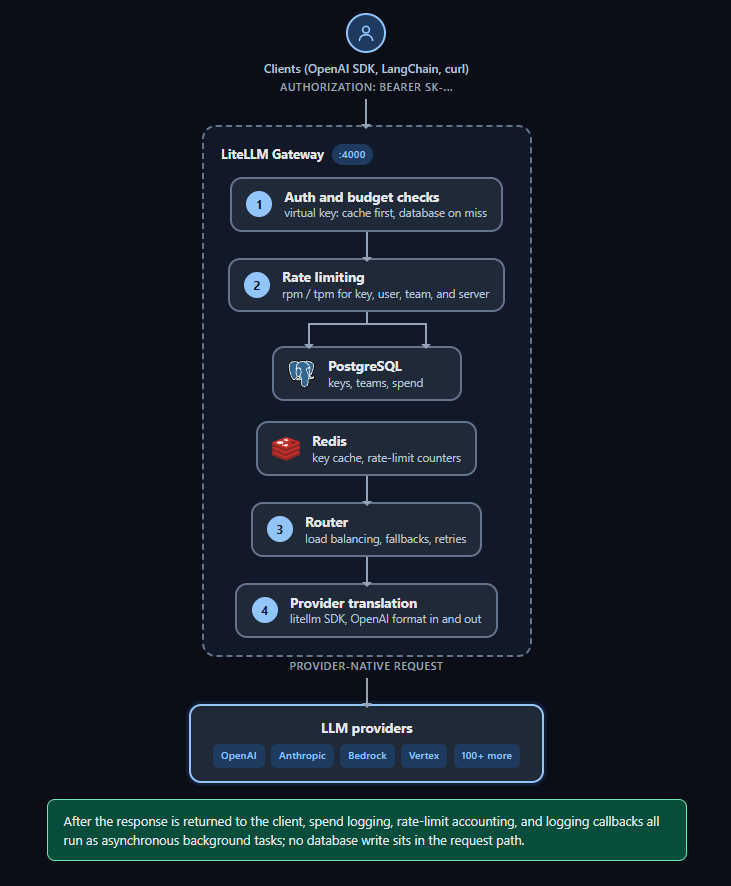
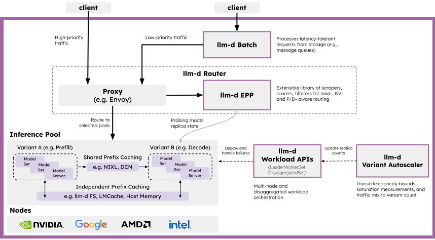
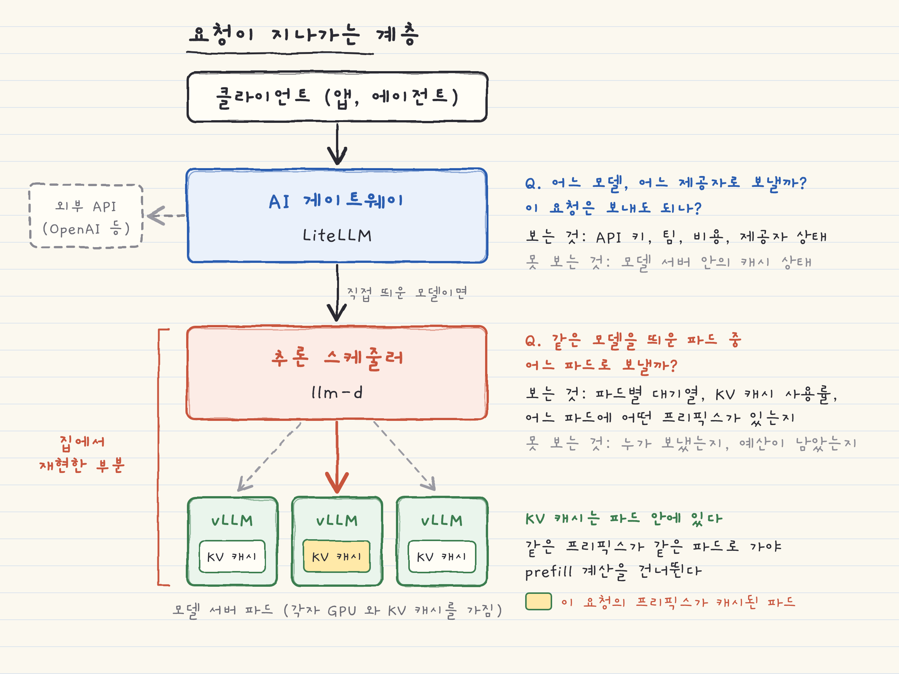

**이 글은 AI를 활용하여 작성되었습니다.**
{: .notice--info}

## 들어가며

LiteLLM을 이전에 LLM 게이트웨이 용도로 활용한 적이 있습니다. AI 서비스에서 원하는 모델을 선택해 라우팅하도록 제공할 수 있고, 해당 모델이 사용 불가하다면 다른 모델이나 외부 모델의 API로 fallback 처리를 시킬 수 있습니다. latency, token, random 방식으로 로드밸런싱을 제공할 수도 있죠. 그리고 최근 사내 세미나에서 LiteLLM과 llm-d로 대표되는 AI 게이트웨이와 추론 스케줄러, 두 계층의 차이를 알아볼 시간이 있었습니다.

처음에는 LiteLLM에도 로드밸런싱이 있는데 굳이 llm-d가 필요한지 의문이 들었습니다. 물론 둘을 같이 사용한다면 직접적으로 로드밸런싱을 하는 건 llm-d일 텐데, 그러면 LiteLLM에서는 단순히 목적지를 llm-d 하나로만 두는 건지, LiteLLM의 로드밸런싱은 사라지는 건지도 궁금했습니다.

해서 둘의 로드밸런싱 메커니즘을 살펴보니, llm-d는 모델 서버(vLLM) 파드의 상태를 직접 보고 로드밸런싱을 하게 됩니다. 어느 파드의 KV 캐시에 어떤 프리픽스가 있는지, 대기열은 어떤지를 보는 것입니다. 반면 LiteLLM이 보는 정보는 토큰 사용량, 응답 시간처럼 바깥에서 관찰한 값입니다. 모델 서버의 현재 상태보다는 요청과 응답에 기반해 로드밸런싱하는 전통적인 로드밸런서에 가깝습니다.



*LiteLLM 게이트웨이의 요청 처리 흐름 (출처: [LiteLLM 공식 문서](https://docs.litellm.ai/))*



*llm-d 아키텍처 (출처: [llm-d 공식 저장소](https://github.com/llm-d/llm-d))*

회사 규모에서는 이 둘이 `클라이언트 → 게이트웨이 → llm-d → vLLM` 순서로 쌓이게 됩니다. 이때 LiteLLM에는 vLLM 파드를 하나씩 등록하지 않고 llm-d의 주소 하나만 등록합니다. 그러면 LiteLLM 입장에서는 고를 대상이 하나뿐이라 어떤 로드밸런싱 방식을 쓰든 결과가 같고, 파드 선택은 전부 llm-d가 하게 됩니다. LiteLLM의 로드밸런싱이 사라진다기보다는, 여러 클러스터나 외부 API 사이를 고르는 한 단계 위의 일만 남는다고 이해했습니다.



여기까지 보고 나니 추론 스케줄러 계층의 필요성에 대해서는 충분히 납득이 갔습니다.

그렇다면 그 효용은 실제로 어느 정도일지가 궁금해졌습니다. 해서 세 가지를 실험해보았습니다. 첫 번째로 프리픽스를 보고 라우팅하는 것만으로 캐시 적중률과 TTFT가 얼마나 달라지는지, 두 번째로 Go로 만든 간단한 추론 스케줄러는 llm-d와 비교해서 어느 정도의 성능을 내는지를 봤습니다. 마지막으로는 KV 오프로딩으로 GPU에서 밀려난 캐시를 다시 불러올 수 있을 때와 그렇지 않을 때의 성능 차이를 지표로 확인했습니다.

글은 이 순서대로 세 편으로 나눴습니다.

| 편 | 주제 |
|---|---|
| 1편 (이 글) | 프리픽스 캐시가 무엇이고, 라우팅이 왜 영향을 주는가 |
| 2편 | Go 프록시와 llm-d는 무엇이 다른가 |
| 3편 | 캐시가 모자랄 때와 KV 오프로딩 |

그리고 이 실험에서는 LiteLLM을 쓰지 않고 스케줄러 계층만 떼어서 봤습니다.

참고로 LiteLLM에도 캐싱 기능이 있지만 그건 응답을 통째로 저장하는 캐시라서, 이 글에서 다루는 KV 캐시와는 다른 것입니다. 그리고 llm-d는 2026년 3월에 CNCF Sandbox에 들어갔고 10월에 1.0이 나왔습니다. Kubernetes에서 직접 모델을 서빙할 때의 표준 후보로 보이지만, 아직 그렇게 단정하기는 이르다고 생각합니다.

## 실험 환경

GPU는 RTX 5070 Ti 16GB 한 장이고, 여기에 vLLM 복제본 3개를 띄워야 해서 모델은 작은 것을 골랐습니다. ~~(누가 Spark 하나만)~~

| 항목 | 내용 |
|---|---|
| GPU | RTX 5070 Ti 16GB 1장 |
| OS | Windows 11 + WSL2 (AlmaLinux 9), docker-ce |
| 서빙 엔진 | vLLM v0.33.0 복제본 3개 (docker compose) |
| 모델 | Qwen2.5-1.5B-Instruct를 4bit(W4A16, AWQ)로 양자화 |
| 라우터 | Go로 만든 프록시 (라운드로빈 / 프리픽스 인지) |
| 부하 생성기 | Go로 만든 멀티턴 대화 생성기 |

양자화는 llm-compressor로 진행했고, 가중치가 3.09GB에서 1.16GB로 줄어들었습니다.

복제본 3개는 GPU 한 장을 같이 쓰게 됩니다. docker compose에서는 별다른 설정 없이도 컨테이너 여러 개가 같은 GPU를 쓸 수 있었습니다. 그리고 몰랐는데 5070 Ti에도 타임슬라이싱이 적용 가능해서, 2편의 Kubernetes 실험에서는 디바이스 플러그인의 타임슬라이싱 설정으로 노드가 `nvidia.com/gpu=4`로 보이도록 두고 파드마다 GPU를 하나씩 요청하게 했습니다. 다만 어느 쪽이든 MIG와 달리(MIG는 데이터센터용 GPU에만 적용 가능합니다) 메모리는 알아서 나눠 주지 않기 때문에 `--gpu-memory-utilization 0.22`로 복제본마다 상한을 걸어 주었습니다. 3개를 다 띄우고 나면 VRAM을 16.3GB 중 12.1GB 사용하고, 복제본 하나가 KV 캐시로 쓸 수 있는 공간은 66,640토큰입니다. 이 옵션을 빼면 어떻게 되는지도 확인해보았는데, 기본값이 0.92라서 첫 번째 복제본부터 기동에 실패했습니다.

```
ValueError: Free memory on device cuda:0 (14.57/15.89 GiB) on startup is less than desired GPU memory utilization (0.92, 14.62 GiB). Decrease GPU memory utilization or reduce GPU memory used by other processes.
```

Windows 화면 출력 등으로 이미 1GiB 남짓을 쓰고 있어서 비어 있는 메모리는 14.57GiB였는데, 기본값으로는 14.62GiB를 요구해 0.05GiB가 모자랐습니다.

## 프리픽스 캐시를 눈으로 보기

라우팅을 보기 전에 vLLM의 프리픽스 캐시가 어떻게 동작하는지부터 확인해보았습니다.

vLLM을 `--enable-prompt-tokens-details`로 띄우면 응답의 `usage`에 `cached_tokens`가 들어오는데, 프롬프트 토큰 중 몇 개가 캐시에서 재사용됐는지 알려 주는 값입니다. 복제본 하나에 curl로 같은 프롬프트를 보내 보았습니다. 시스템 프롬프트는 같은 문장을 60번 반복한 것이고, 사용자 메시지는 `hello`입니다.

| 요청 | prompt_tokens | cached_tokens | 시간 |
|---|---|---|---|
| 처음 보냄 | 675 | 0 | 0.196s |
| 같은 프롬프트를 다시 | 675 | 672 | 0.080s |
| 끝 글자만 바꿈 (`hello` → `ello`) | 675 | 656 | 0.063s |

처음에는 캐시가 없으니 0이고, 같은 프롬프트를 다시 보내면 675토큰 중 672토큰이 캐시에서 나옵니다. 675가 아니라 672인 이유는 vLLM이 16토큰짜리 블록 단위로 캐시하고, 꽉 찬 블록만 캐시하기 때문입니다. 해서 16의 배수인 672까지만 적중하게 됩니다.

끝 글자를 바꾸면 656이 나오는데, 672에서 정확히 블록 하나(16토큰)만큼 줄어든 값입니다. 바뀐 글자가 들어 있는 마지막 블록만 못 쓰게 된 것이죠.

그렇다면 맨 앞 글자를 바꾸면 어떻게 될까요?

| 요청 | prompt_tokens | cached_tokens |
|---|---|---|
| 원래 프롬프트 (캐시 비어 있음) | 675 | 0 |
| 맨 앞 글자만 `X`로 바꿈 | 676 | 0 |

바로 직전에 675토큰이 캐시됐는데도 0이 나왔습니다. 끝을 바꿨을 때는 656토큰을 재사용했는데, 앞을 바꾸니 하나도 쓰지 못합니다. 블록의 해시가 앞에 있는 블록 전체에 의존하기 때문에, 캐시는 앞에서부터 연속으로 일치하는 만큼만 재사용되는 것입니다. 프리픽스 캐시라는 이름 그대로입니다.

여기서 라우팅이 왜 영향을 주는지가 나옵니다. 캐시는 복제본마다 따로 있기 때문에, 같은 시스템 프롬프트로 시작하는 요청이라도 그 프리픽스를 한 번도 본 적 없는 복제본으로 가면 처음부터 다시 계산해야 합니다. 멀티턴 대화라면 이전 턴까지의 내용이 전부 프리픽스이니, 대화가 매 턴 다른 복제본으로 가게 되면 손해가 더 커집니다.

## Go로 만든 프록시

프록시가 하는 일은 단순합니다.

1. 요청의 프롬프트를 256바이트 단위 블록으로 자르고, vLLM처럼 앞 블록에 의존하는 체인 해시를 만듭니다.
2. 어떤 블록을 어느 복제본으로 보냈는지를 LRU 테이블에 기억해 둡니다.
3. 새 요청이 오면 복제본마다 앞에서부터 몇 블록이나 가지고 있을지를 세어서 점수를 매깁니다.

점수는 `2 × 프리픽스 일치 비율 + 1 × 여유도`로 계산하고, 여유도는 처리 중인 요청 수가 적을수록 높습니다. 그리고 가장 한가한 복제본보다 처리 중인 요청이 4개 넘게 많은 복제본은 후보에서 빼도록 했습니다. 이 규칙이 없으면 공유 시스템 프롬프트를 처음 받은 복제본으로 모든 요청이 몰리기 때문입니다. 물론 가중치 2, 1과 문턱값 4는 근거가 있는 값은 아니고 처음에 임의로 정한 값입니다.

한 가지 짚어 둘 점은, 이 프록시는 vLLM의 실제 캐시 상태를 모른다는 것입니다. 보냈으니 거기 있을 것이라고 믿을 뿐이고, 토크나이저도 없어서 토큰이 아니라 바이트로 블록을 나눕니다. 이런 방식을 근사(approximate)라고 부르는데, llm-d의 근사 프리픽스 라우팅도 같은 방식입니다. 이와 다른 정밀 방식의 경우는 2편과 3편에서 다루겠습니다.

## 라운드로빈 대 Go 프록시

### 부하

부하 생성기는 멀티턴 대화를 흉내 내도록 만들었습니다.

- 대화 48개, 대화마다 5턴, 동시에 8개 대화 진행 (요청 240건)
- 시스템 프롬프트 4종(각 약 560토큰)을 대화들이 나눠 씀
- 턴마다 최대 64토큰 생성

적중률은 응답의 `cached_tokens` 합을 `prompt_tokens` 합으로 나눈 값입니다. 프록시의 추정이 아니라 vLLM이 실제로 재사용했다고 알려 준 값입니다.

### 예측

실험 전에 예상한 결과는 아래와 같습니다.

> 라운드로빈은 멀티턴에서 이전 대화가 현재 질문과 이어지는데도 이를 인식하지 않고 다음 복제본으로 보내므로 적중률이 낮다. 프리픽스 쪽은 이전 턴이 캐싱되어 있는 복제본으로 들어가므로 적중률이 높다.
>
> 첫 턴의 TTFT는 비슷하다. 대화가 누적될수록 프리픽스 쪽이 더 빨라진다.

### 결과

정책마다 순서를 바꿔 가며 2번씩 돌렸습니다.

| 정책 | 적중률 | 처리량 (tok/s) | TTFT p50 | 이후 턴 TTFT p50 |
|---|---|---|---|---|
| 라운드로빈 | 0.71 | 749~785 | 57~59ms | 58~60ms |
| Go 프록시 | 0.90 | 819~827 | 53~54ms | 54~55ms |

부하 생성기가 실행마다 남기는 요약에서 두 정책의 첫 번째 실행을 일부 항목만 추려 보면 다음과 같습니다.

```json
{"label": "rr", "prompt_tokens": 198329, "cached_tokens": 141216, "actual_hit_ratio": 0.7120290023143363, "per_backend": {"v0": 80, "v1": 80, "v2": 80}}
{"label": "prefix", "prompt_tokens": 198333, "cached_tokens": 178400, "actual_hit_ratio": 0.8994973100795127, "per_backend": {"v0": 120, "v1": 60, "v2": 60}}
```

`actual_hit_ratio`는 `cached_tokens`를 `prompt_tokens`로 나눈 값이고, `per_backend`는 복제본별로 보낸 요청 수입니다. 같은 양의 프롬프트에서 캐시로 재사용한 토큰이 약 14만에서 약 18만으로 늘었습니다.

방향은 예측대로 적중률이 0.71에서 0.90으로 올랐고 처리량도 올랐습니다. 하지만 그 크기는 예상보다 작았는데, 두 가지가 눈에 띄었습니다.

첫 번째는 라운드로빈의 적중률이 0.71이나 나왔다는 점입니다. 캐시를 전혀 고려하지 않는데도 그렇습니다. 이유는 부하에 있었습니다. 시스템 프롬프트 약 560토큰이 프롬프트의 대부분을 차지하는데 종류가 4개뿐이고 복제본은 3개이니, 조금만 지나면 모든 복제본이 4종을 전부 캐시하게 됩니다. 어디로 보내든 시스템 프롬프트 부분은 적중하고, 라운드로빈이 놓치는 것은 대화가 쌓인 부분뿐이었던 것입니다.

두 번째는 TTFT 차이가 4~5ms밖에 나지 않았다는 점입니다. 적중률은 0.19나 벌어졌는데 TTFT는 거의 그대로였고, 대화가 누적될수록 빨라질 것이라는 예측도 눈에 띄게 나타나지 않았습니다. 프롬프트의 길이가 매우 짧았기 때문인데, 지금까지 봐왔던 프로덕션용 시스템 프롬프트(5,000~12,000토큰까지도 봤던 것 같습니다)에 비하면 560토큰은 작은 양입니다. 3편에서 프롬프트 길이별로 따로 실측한 후에는 이 차이를 더 크게 볼 수 있었습니다.

요청 분배도 확인해보았습니다. Go 프록시는 복제본 3개에 요청을 120 / 60 / 60으로 보냈는데, 시스템 프롬프트 4종을 복제본 3개에 나누다 보니 한 곳이 2종을 맡게 된 것입니다. 한가한 복제본보다 4개 넘게 바쁘면 빼는 규칙은 이 부하에서 한 번도 개입하지 않았습니다.

캐시를 따라가면 요청이 몰리고, 고르게 나누면 캐시를 버리게 됩니다. 추론 스케줄러가 풀어야 하는 문제가 결국 이것이라는 걸 여기서 체감할 수 있었습니다.

## 차이를 키워 보기

기본 부하에서는 라운드로빈도 적중률이 높게 나왔기 때문에, 조건을 바꿔서 차이를 키워 보았습니다. 실험 전 예측은 다음과 같았습니다.

> 시스템 프롬프트 길이를 늘리면 그만큼 캐시 효율이 증가하므로 프리픽스 쪽의 TTFT가 상대적으로 빨라진다. 턴 수 역시 길어질수록 전체 프롬프트 대비 캐시 효율이 증가한다.

이 중 턴 수는 5턴에서 12턴으로 늘려서 확인했습니다. 시스템 프롬프트 길이는 여기서는 바꾸지 않았고, 3편에서 프롬프트 길이별 TTFT를 따로 재면서 확인했습니다. 대신 여기서는 시스템 프롬프트의 종류를 4종에서 32종으로 늘린 조건을 추가했습니다. 4종일 때는 모든 복제본이 금방 전부를 캐시해서 정책 차이가 묻혔기 때문입니다.

| 조건 | 정책 | 적중률 | 처리량 (tok/s) | 이후 턴 TTFT p50 |
|---|---|---|---|---|
| 12턴 | 라운드로빈 | 0.77 | 712~733 | 64~65ms |
| | Go 프록시 | 0.94 | 809~814 | 52~55ms |
| 시스템 프롬프트 32종 | 라운드로빈 | 0.50~0.53 | 673~705 | 67~68ms |
| | Go 프록시 | 0.83 | 797~809 | 56~61ms |

턴 수에 대한 예측은 맞았습니다. 12턴으로 늘리니 양쪽 다 적중률이 올랐는데, 대화가 길어질수록 프롬프트에서 이미 본 부분의 비중이 커지기 때문입니다.

반면 종류를 늘린 쪽은 양쪽 다 적중률이 떨어졌습니다 (라운드로빈 0.71 → 0.50~0.53, Go 프록시 0.90 → 0.83). 종류가 많아지면 캐시에 있는 내용과 맞지 않는 프리픽스가 그만큼 많이 들어오니 당연한 결과입니다.

대신 격차가 벌어져서, 0.19였던 차이가 0.30 이상이 됐습니다. 32종이 되면 어느 복제본이 무엇을 가지고 있는지를 아는 쪽과 모르는 쪽의 차이가 드러나게 됩니다. 종류가 늘어나면 캐시 효율은 떨어지지만 라우팅의 효용은 커지는 셈입니다.

## 예상 못 한 결과, 복제본 1개가 3개보다 빠르다

구성을 일부러 바꿔 가며 망가뜨려 보는 실험도 진행했는데, 여기서 예상하지 못한 결과가 나왔습니다. 같은 GPU에 복제본을 1개만 띄운 것과 3개 띄운 것을 비교한 결과입니다 (대화 96개, 조건당 1회).

| 동시 대화 수 | 복제본 1개 | 3개 라운드로빈 | 3개 Go 프록시 |
|---|---|---|---|
| 8 | 1,698 tok/s | 753 | 797 |
| 24 | 3,472 tok/s | 1,788 | 2,030 |
| 48 | 3,827 tok/s | 2,775 | 3,489 |

모든 구간에서 복제본 1개가 가장 빨랐고, 동시 8에서는 2배가 넘게 차이가 났습니다.

복제본 3개가 GPU 한 장의 연산을 나눠 쓰기 때문이라고 추정하고 있습니다. vLLM 하나는 들어온 요청을 한 배치로 묶어 처리하는데, 3개로 나누면 배치도 셋으로 쪼개지고 GPU를 번갈아 쓰게 됩니다. 다만 이 원인을 따로 분리해서 확인하지는 못했습니다. 그리고 지연시간은 조금 달라서, 동시 8에서 TTFT p50은 복제본 3개 쪽이 오히려 낮았습니다 (55~59ms 대 69ms).

이 결과로 실험의 전제가 분명해졌습니다. GPU가 한 장이면 복제본을 늘릴 이유가 없고, 이 실험은 처리량을 늘리는 실험이 아니라 **GPU 여러 장에 복제본이 하나씩 있는 상황을 한 장으로 흉내 낸 것** 입니다. 해서 처리량의 절댓값보다는 같은 복제본 3개 위에서 정책끼리 비교한 값에 의미가 있습니다.

그렇게 보면 동시 48에서 라운드로빈 2,775 대 Go 프록시 3,489 tok/s가 눈에 들어옵니다. 부하가 높을수록 라우팅에 따른 처리량 차이가 커졌습니다.

## 마무리

처음의 의문으로 돌아가서, 추론 스케줄러 계층의 효용에 대해 1편에서 확인한 것은 다음과 같습니다.

| 질문 | 답 | 근거 |
|---|---|---|
| 캐시 적중률을 올리는가 | 예 | 0.71 → 0.90, 시스템 프롬프트 32종에서 0.50~0.53 → 0.83 |
| 처리량을 올리는가 | 예, 부하가 높을수록 | 749~785 → 819~827 tok/s, 동시 48에서 2,775 → 3,489 tok/s |
| TTFT를 줄이는가 | 이 부하에서는 조금 | p50 57~59 → 53~54ms |
| 요청을 고르게 나누는가 | 아니오 | 120 / 60 / 60으로 치우침 |

물론 한계도 있습니다.

- GPU 한 장을 복제본 3개가 나눠 쓰는 구성이라, GPU가 여러 장인 환경과 수치가 같을 수는 없습니다.
- 대부분의 조건은 2번씩, 복제본 수 비교는 1번씩만 돌렸습니다.

여기까지 하고 나니, 400줄 남짓의 Go 프록시가 이 정도라면 llm-d는 무엇이 더 나은지가 궁금해졌습니다. 다음 [2편]({{ site.baseurl }})에서는 실험을 k3s로 옮겨서 llm-d의 근사, 정밀 방식과 Go 프록시를 같은 부하로 비교해보겠습니다. llm-d가 k8s를 전제로 하기도 하고, k8s가 더 익숙해 이쪽으로 옮겼습니다. 그리고 결과를 미리 말하면 평상시에는 차이가 없었고, 라우터를 재시작하거나 파드 수를 바꿀 때 차이가 났습니다.

## 참고 자료

- vLLM Documentation. *Automatic Prefix Caching*. [docs.vllm.ai](https://docs.vllm.ai/en/stable/design/prefix_caching/)
- llm-d. [llm-d.ai](https://llm-d.ai/)
- LiteLLM Documentation. *Router - Load Balancing*. [docs.litellm.ai](https://docs.litellm.ai/docs/routing)
- llm-compressor. [github.com/vllm-project/llm-compressor](https://github.com/vllm-project/llm-compressor)
