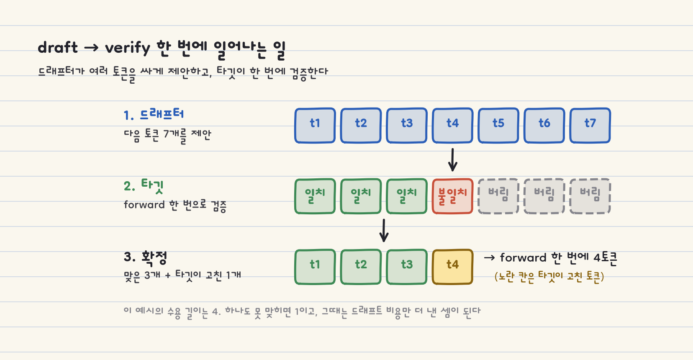
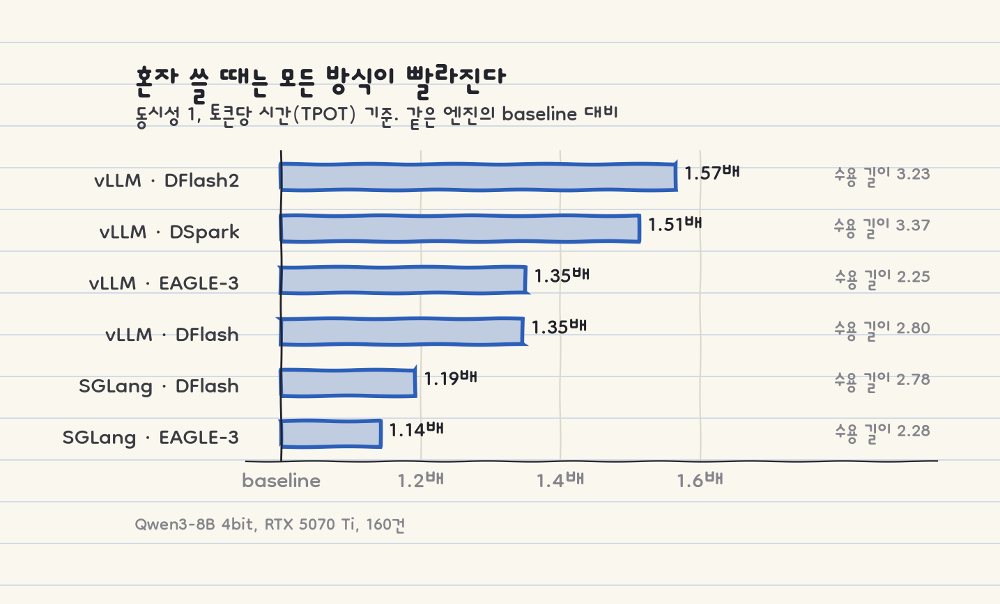
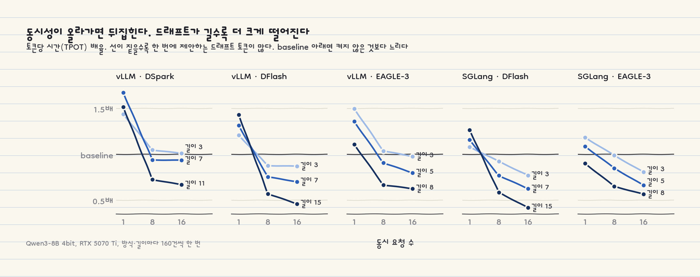
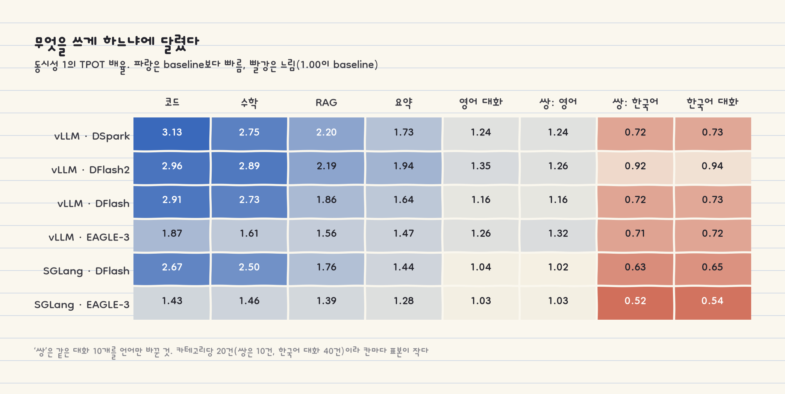
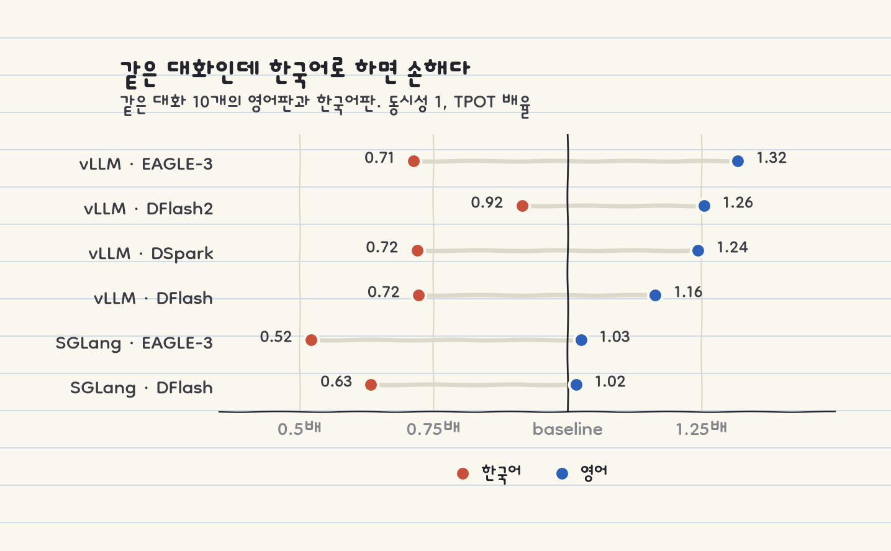
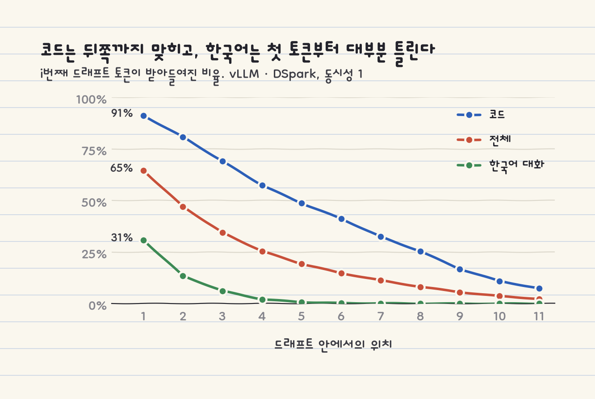

**이 글은 AI를 활용하여 작성되었습니다.**
{: .notice--info}

## 들어가며

Speculative Decoding(이하 specdec)은 "켜면 빨라진다"는 말을 자주 듣는 기능입니다. vLLM이나 SGLang 문서를 봐도 플래그 한 줄이면 켤 수 있고, 모델 카드에는 2배, 3배 빨라졌다고 적혀 있습니다. 저도 현재 진행 중인 프로젝트에서 Qwen 모델에 내장된 MTP를 켜고 테스트를 진행한 결과, 2배 정도 TPOT가 빨라진 것을 관찰했었습니다(수용률 70%, 동시성 8).

해당 모델은 사내 코딩 에이전트를 운용하기 위한 모델이었고, 이 정도 동시성에서도 충분한 성능이었습니다.

해소되지 않은 궁금증도 있어서 그 외에 다른 specdec 모델들의 성능은 어떤지, 그리고 여러 변인들을 바꿔보며 NVIDIA SPEED-Bench와 다른 한국어 기반 테스트를 진행했습니다.

아래 3가지를 집중적으로 체크했습니다.

1. 켜면 얼마나 빨라지는지, 방식마다 다른지
2. 요청이 동시에 여러 개 들어와도 빨라지는지
3. 어떤 요청에서 잘 되고 어떤 요청에서 안 되는지

해서 집에 있는 RTX 5070 Ti 한 장으로 재보았습니다. 결론부터 말씀드리면 아래와 같습니다.

- 혼자 쓸 때(동시성 1)는 모든 방식이 **1.14~1.57배** 빨라졌습니다
- 동시 요청이 8개가 되자 모든 방식이 켜지 않은 것보다 **느려졌습니다**
- 코드와 수학에서는 3배 가까이 빨라졌지만 한국어 대화에서는 **오히려 손해** 였습니다
- 다만 H200에서 27B 모델로 재 보니 동시성 8에서도 2배 가까이 빨랐습니다

H200에서는 동시 요청 8개까지 응답이 빨라졌던 것과는 달리 5070 Ti에서는 연산 여유가 모자라 응답이 느려진 것으로 보이고, 이를 통해 GPU와 모델 크기에 따라 결과가 달라짐을 알 수 있습니다.

이런 이유로 마지막에 H200에서 27B 모델로 한 케이스를 더 재서 비교했습니다.

수치 자체보다는 방향을 보는 글입니다. 4bit로 양자화한 8B 모델을 16GB GPU에서, 방식마다 한 번씩 잰 값이라 모델 카드나 논문의 숫자와 나란히 놓고 비교할 수는 없습니다.

## Speculative Decoding 한 장 요약

LLM은 토큰 하나를 만들 때마다 모델 전체를 한 번 통과(forward)하기 때문에, 100토큰을 만들려면 100번을 돌아야 합니다. specdec은 이 횟수를 줄이려는 방법으로, 싸게 여러 토큰을 미리 써 보고(draft) 원래 모델이 그걸 한 번에 검증(verify)하게 됩니다.



드래프터가 7개를 제안했는데 앞의 3개가 맞았다면, 타깃 모델은 forward 한 번으로 4토큰(맞은 3개 + 자기가 고친 1개)을 확정합니다. 검증은 타깃 모델이 직접 하기 때문에 타깃의 가중치는 바뀌지 않고, 학습되는 것은 드래프터뿐입니다.

이 글에서 쓰는 용어는 두 개입니다.

- **수용 길이** 는 검증 한 번에 확정되는 토큰 수의 평균입니다. 1.00이면 드래프트가 하나도 안 맞았다는 뜻입니다
- **TPOT 배율** 은 baseline의 토큰당 시간(TPOT)을 specdec의 토큰당 시간으로 나눈 값입니다. 1보다 크면 빨라진 것입니다

여기서 baseline은 같은 엔진에서 specdec만 끈 것입니다. 엔진은 vLLM과 SGLang 두 가지를 사용했습니다.

### 드래프터는 "작은 모델"이 아닙니다

처음에는 드래프터가 0.5B짜리 작은 LLM 같은 것이라고 생각했습니다. 실제로 옛날에는 그런 방식을 사용했지만 요즘의 아키텍처는 타깃 모델의 중간 층 hidden state를 받아서 다음 토큰들을 예측하는 작은 헤드에 가깝다고 합니다. 예를 들어 DFlash 드래프터는 자기 임베딩도 출력 헤드도 없어서, 타깃 없이는 아무것도 쓰지 못합니다.

이번에 잰 방식은 네 가지이고, Qwen3-8B용으로 공개된 드래프터 기준입니다.

| | EAGLE-3 | DFlash | DFlash2 | DSpark |
|---|---|---|---|---|
| 제안하는 방법 | 한 토큰씩 이어서 | 블록을 한 번에 | 블록을 한 번에 + 후보 선택기 | 블록을 한 번에 + 순차 보정 |
| 드래프터 크기 | 1층, 1.02B | 5층, 1.05B | 가중치 2.3GB | 5층, 2.37B |
| 타깃에서 읽는 것 | 3개 층의 hidden state | 5개 층의 hidden state | 5개 층의 hidden state | 5개 층의 hidden state |
| 이번에 쓴 드래프트 길이 | 5 | 7 | 7 | 11 |
| 잰 엔진 | vLLM, SGLang | vLLM, SGLang | vLLM | vLLM |

드래프트 길이는 엔진 문서와 블로그에 나온 예시 값을 그대로 썼습니다. DFlash2는 층 수와 파라미터 수를 확인하지 못해 가중치 파일 크기만 적었습니다.

한 가지 주의할 점은 EAGLE-3 드래프터가 엔진마다 다르다는 것입니다. 체크포인트 형식이 달라서 vLLM은 RedHatAI, SGLang은 Tengyunw에서 올린 것을 썼습니다. 그래서 두 엔진을 같은 드래프터로 비교할 수 있는 건 DFlash뿐입니다.

## 어떻게 쟀나

| 항목 | 값 |
|---|---|
| GPU | RTX 5070 Ti 16GB (WSL2 위 k3s) |
| 타깃 모델 | `Qwen/Qwen3-8B-AWQ` (4bit), `--dtype bfloat16` |
| 엔진 | vLLM v0.33.0, SGLang v0.5.23 |
| 프롬프트 | 160개 (SPEED-Bench 일부 100개 + 따로 만든 한국어 60개) |
| 샘플링 | temperature 0, thinking off, 최대 출력 1,024토큰 |
| 동시성 | 1, 8 (드래프트 길이 스윕은 16까지) |
| 실패 요청 | 0건 |

### 16GB에 맞추기

specdec은 타깃과 드래프터를 같은 GPU에 같이 올려야 합니다.

- BF16 그대로의 8B 모델은 16.4GB라 아예 들어가지 않습니다
- FP8(8.8GiB)은 들어가긴 하는데, 드래프터를 얹고 나면 KV 캐시 자리가 없어서 DFlash가 두 엔진 모두 기동에 실패했습니다
- 해서 4bit AWQ(5.7GB)로 갔습니다

또 데스크톱 화면도 이 GPU가 그리고 있어서 1.3GiB 정도가 이미 쓰이고 있었습니다. 그래서 vLLM을 기본값으로 띄우면 0.05GiB가 모자라 기동이 거부됐고, `--gpu-memory-utilization`을 0.85로 낮춰서 해결했습니다.

### 프롬프트

NVIDIA의 SPEED-Bench에서 5개 카테고리(코드, 수학, RAG, 요약, 대화)를 20개씩 가져오고, 여기에 한국어 60개를 따로 만들어 더했습니다. 한국어 60개는 한국어 대화 40개와, 같은 대화를 영어와 한국어로 각각 쓴 쌍 10개씩입니다.

따라서 이 테스트는 공식 "SPEED-Bench 점수"가 아니고, 공식 절차 그대로 돌린 SPEED-Bench 결과는 아래에서 따로 한 번 나옵니다.

### 재는 방법

- 스트리밍 응답의 토큰 간격을 재는 클라이언트를 만들어 썼습니다
- 방식마다 서버를 새로 띄우고 워밍업 3건을 보낸 뒤 측정했습니다
- 요청마다 서버가 돌려주는 수용 통계를 같이 기록했습니다
- 서버는 k3s에 Deployment + Service + HTTPRoute로 올리고 게이트웨이를 거쳐서 쟀습니다

평소에도 해보고 싶은 건 k8s 환경에서 테스트하는 편이고, 측정은 실제 배포와 같은 경로로 해야 한다고 생각했습니다. 기동 시간은 vLLM이 4~5분, SGLang이 6~11분 정도였고, 방식 하나를 재는 데 30분 안팎이 걸렸습니다.

## 동시성 1

먼저 동시성 1에서의 결과입니다.



| 엔진 | 방식 | 수용 길이 | TPOT | TPOT 배율 | 출력 tok/s |
|---|---|---|---|---|---|
| vLLM | baseline | | 7.50ms | | 128 |
| vLLM | DFlash2 | 3.23 | 4.90ms | 1.57× | 240 |
| vLLM | DSpark | 3.37 | 4.96ms | 1.51× | 222 |
| vLLM | DFlash | 2.80 | 5.57ms | 1.35× | 214 |
| vLLM | EAGLE-3 | 2.25 | 5.56ms | 1.35× | 172 |
| SGLang | baseline | | 7.18ms | | 133 |
| SGLang | DFlash | 2.78 | 6.02ms | 1.19× | 200 |
| SGLang | EAGLE-3 | 2.28 | 6.29ms | 1.14× | 149 |

모든 방식이 1.14~1.57배 빨라졌고, 여기까지는 기대한 대로입니다. 다만 표를 보면서 눈에 들어온 점이 두 가지 있었습니다.

첫 번째는 수용 길이가 길다고 꼭 그만큼 빨라지지는 않는다는 점입니다. vLLM에서 DFlash(2.80)와 EAGLE-3(2.25)는 수용 길이가 꽤 다른데 배율은 똑같이 1.35배입니다. 드래프트를 한 번 만드는 비용이 방식마다 다르기 때문입니다.

두 번째는 같은 드래프터인데 엔진에 따라 속도가 다르다는 점입니다. DFlash의 수용 길이는 vLLM 2.80, SGLang 2.78로 사실상 같은데, 같은 드래프터가 같은 토큰을 제안하니 당연한 결과입니다. 반면 배율은 vLLM 1.35배, SGLang 1.19배입니다. 같은 드래프트를 처리하는 비용이 엔진마다 다르다는 뜻입니다.

그리고 DFlash2와 DSpark의 차이(1.57배, 1.51배)는 한 번씩 잰 값이라 어느 쪽이 더 빠르다고 말하기는 어렵습니다.

전체로 보면 DFlash2와 DSpark가 앞쪽에 있었습니다.

## 동시성 8

이 글에서 가장 하고 싶었던 이야기입니다. 같은 측정을 동시성 8로 올리면 아래와 같이 됩니다.

| 엔진 | 방식 | TPOT | TPOT 배율 | 처리량 배율 |
|---|---|---|---|---|
| vLLM | baseline | 9.59ms | | |
| vLLM | EAGLE-3 | 10.46ms | 0.92× | 0.96× |
| vLLM | DFlash2 | 11.18ms | 0.86× | 1.18× |
| vLLM | DFlash | 11.94ms | 0.80× | 1.08× |
| vLLM | DSpark | 12.94ms | 0.74× | 0.93× |
| SGLang | baseline | 9.24ms | | |
| SGLang | EAGLE-3 | 10.59ms | 0.87× | 0.91× |
| SGLang | DFlash | 11.43ms | 0.81× | 1.07× |

모든 방식의 토큰당 시간이 baseline보다 길어졌습니다(0.74~0.92배). 동시성 1에서 1.51배로 앞쪽에 있던 DSpark가 여기서는 가장 느립니다.

표에 배율이 두 개 있는데, 둘이 같은 방향을 가리키지 않는 칸이 있습니다. TPOT 배율은 요청 하나하나의 토큰당 시간(중앙값)으로 계산한 값이고, 처리량 배율은 측정 구간 전체에서 서버가 초당 내보낸 토큰 수로 계산한 값입니다. DFlash는 TPOT로 보면 0.80배인데 처리량으로 보면 1.08배입니다. 이 글에서는 TPOT 배율을 기준으로 삼았는데, specdec이 사용자가 체감하는 토큰 속도를 올리려는 기술이기 때문입니다. 처리량은 필요한 곳에서 같이 적겠습니다.

### 드래프트 길이를 바꿔 보면

드래프트 길이도 바꿔 가며 다시 재보았습니다. 동시성은 16까지 올렸습니다.



| 엔진 | 방식 | 길이 | 수용 길이 | 동시성 1 | 동시성 8 | 동시성 16 |
|---|---|---|---|---|---|---|
| vLLM | DSpark | 3 | 2.58 | 1.44 | 1.05 | 1.01 |
| vLLM | DSpark | 7 | 3.32 | 1.67 | 0.94 | 0.94 |
| vLLM | DSpark | 11 | 3.37 | 1.52 | 0.72 | 0.67 |
| vLLM | DFlash | 3 | 2.31 | 1.21 | 0.88 | 0.87 |
| vLLM | DFlash | 7 | 2.76 | 1.31 | 0.75 | 0.70 |
| vLLM | DFlash | 15 | 3.09 | 1.43 | 0.57 | 0.46 |
| vLLM | EAGLE-3 | 3 | 2.12 | 1.50 | 1.04 | 0.98 |
| vLLM | EAGLE-3 | 5 | 2.26 | 1.36 | 0.91 | 0.80 |
| vLLM | EAGLE-3 | 8 | 2.32 | 1.11 | 0.67 | 0.63 |
| SGLang | DFlash | 3 | 2.32 | 1.08 | 0.92 | 0.77 |
| SGLang | DFlash | 7 | 2.78 | 1.16 | 0.77 | 0.62 |
| SGLang | DFlash | 15 | 3.05 | 1.26 | 0.58 | 0.42 |
| SGLang | EAGLE-3 | 3 | 2.11 | 1.18 | 0.99 | 0.81 |
| SGLang | EAGLE-3 | 5 | 2.28 | 1.09 | 0.85 | 0.66 |
| SGLang | EAGLE-3 | 8 | 2.34 | 0.90 | 0.65 | 0.56 |

숫자는 모두 TPOT 배율입니다. 앞의 표와 다른 날 잰 것이라 같은 조건이어도 값이 조금 다릅니다(vLLM DFlash 길이 7이 앞에서는 1.35배, 여기서는 1.31배).

- 동시성이 높을수록, 드래프트가 길수록 더 크게 떨어집니다. 가장 나쁜 칸은 DFlash 길이 15의 동시성 16으로 0.42~0.46배입니다. 켰더니 절반 속도가 된 것입니다
- 드래프트를 길게 해도 수용 길이는 금방 포화합니다. DSpark는 7에서 11로 늘려도 3.32에서 3.37이 될 뿐입니다. 반면 검증해야 할 토큰은 그대로 늘어납니다
- 드래프트를 3으로 줄이면 손해가 거의 사라집니다. 동시성 16에서 본전 이상인 건 vLLM DSpark 길이 3(1.01배) 하나뿐입니다
- 동시성 1에서 가장 좋은 길이는 방식마다 다릅니다. DFlash는 15, DSpark는 7, EAGLE-3는 3이었습니다

혼자 쓸 때는 GPU 연산이 남아돌아서 드래프트와 검증을 그 여유로 처리할 수 있습니다. 반면 배치가 커지면 그 여유가 사라지고, 틀린 드래프트를 검증하는 데 쓴 연산이 그대로 손해가 되는 것으로 보입니다.

### 공식 SPEED-Bench로도 같은 방향

이번에 구성한 프롬프트 셋이 문제일 수도 있어서 SPEED-Bench를 공식 절차대로(11개 카테고리, 카테고리당 80건, 동시성 16) 한 번 더 돌려보았습니다.

| 엔진 | baseline 처리량 | specdec 처리량 배율 |
|---|---|---|
| vLLM | 929 tok/s | 0.79~0.85× |
| SGLang | 920 tok/s | 0.87~0.88× |

두 엔진 모두 specdec을 켠 쪽의 처리량이 낮았습니다.

## 프롬프트를 나눠서 테스트

다시 동시성 1로 돌아와서, 이번에는 요청의 종류별로 나눠 보았습니다.



코드와 수학에서는 최대 3.13배까지 빨라집니다. 반면 한국어 대화에서는 모든 방식이 baseline보다 느립니다(0.52~0.94배).

"한국어 대화는 내용이 달라서 그런 거 아닌가" 싶을 수 있어서 같은 대화 10개를 언어만 바꿔서 비교해보았습니다.



영어로 하면 1.02~1.32배, 한국어로 하면 0.52~0.92배입니다. 같은 대화인데 언어만 바꿔도 이득과 손해가 갈리게 됩니다. 그리고 드래프트 안에서 몇 번째 토큰까지 맞는지를 보면 그 이유가 보입니다.



코드는 첫 번째 드래프트 토큰의 91%가 맞고 11번째도 7%가 맞습니다. 반면 한국어 대화는 첫 번째 토큰이 31%만 맞고 네 번째부터는 거의 0입니다. 드래프트를 거의 못 맞히면서 드래프트와 검증 비용만 내고 있는 셈이죠.

드래프터가 영어 위주의 데이터로 학습됐기 때문이라고 보는 게 자연스럽습니다. 다만 드래프터의 학습 데이터를 직접 확인하지는 못했습니다.

### 긴 생성에 유리한가

specdec은 긴 생성에서 유리하다는 이야기도 있어서 출력 길이별로도 나눠 보았습니다(vLLM, 동시성 1).

| 출력 토큰 | DFlash | DSpark | EAGLE-3 | 요청 수 |
|---|---|---|---|---|
| 128 미만 | 0.93× | 0.97× | 0.76× | 57~59 |
| 128~384 | 1.35× | 1.52× | 1.42× | 61~65 |
| 384~900 | 2.57× | 2.59× | 1.64× | 21~22 |
| 900 이상 | 2.62× | 2.74× | 1.62× | 17~18 |

겉으로 보면 길수록 빠릅니다. 하지만 이 데이터에서는 길이와 내용이 얽혀 있는데, 짧은 응답은 대부분 한국어 대화이고 긴 응답은 수학과 코드이기 때문입니다. 해서 카테고리를 고정하고 그 안에서 짧은 쪽과 긴 쪽을 나눠 보니 차이가 뚜렷하지 않았습니다(DSpark 기준 코드 3.08배 / 3.30배, RAG 2.27배 / 1.94배, 요약 1.76배 / 1.67배).

각 10개씩이라 단정하기는 어렵지만, 이 데이터에서 결과를 가른 것은 길이보다 내용이었고, 드래프터가 예측하기 쉬운 출력인지가 중요했습니다.

## H200에서 테스트

여기까지 쓰고 나니 "작은 GPU라서 그런 거 아닌가"라는 의문이 남았습니다. 해서 H200 한 장을 빌려서 한 케이스만 더 재보았습니다. 타깃은 Qwen3.8-27B(BF16), 엔진은 SGLang, 프롬프트는 같은 160개입니다.

| 방식 | 수용 길이 | 동시성 1 TPOT 배율 | 동시성 8 TPOT 배율 | 동시성 32 처리량 배율 | 동시성 32 TTFT p50 |
|---|---|---|---|---|---|
| baseline | | (14.43ms) | (16.89ms) | (1,078 tok/s) | 0.1초 |
| DFlash2 | 3.62 | 2.56× | 1.95× | 1.22× | 3.8초 |
| MTP | 2.95 | 2.15× | 1.87× | 1.31× | 2.0초 |

MTP는 모델에 내장된 헤드를 드래프터로 쓰는 방식입니다.

- 동시성 8에서도 2배 가까이 빠릅니다. 5070 Ti에서는 같은 동시성에서 전부 baseline보다 느렸습니다
- 동시성 1의 이득도 5070 Ti(1.14~1.57배)보다 큽니다. 타깃이 클수록 forward 한 번을 아끼는 값이 크기 때문으로 보입니다
- 27B에서는 한국어도 손해가 아니었습니다(1.14~1.61배). 다만 영어와의 차이는 그대로였습니다(같은 대화 쌍에서 DFlash2가 영어 2.04배, 한국어 1.14배)

물론 5070 Ti와는 모델, 정밀도, 측정 경로가 모두 달라서 숫자를 직접 비교할 수는 없습니다. 그래도 "동시성이 오르면 손해"라는 앞의 결론이 GPU에 연산 여유가 없을 때의 이야기라는 점은 분명해졌습니다.

대신 다른 비용이 보였습니다. 동시성 32에서 첫 토큰까지 걸리는 시간(TTFT)이 baseline은 0.1초인데 specdec은 2~4초입니다. SGLang이 동시에 처리하는 요청 수를 baseline 42개에서 MTP 21개, DFlash2 14개로 줄였고, 나머지 요청은 줄을 서서 기다리게 됩니다. 드래프터가 GPU 메모리를 쓰는 만큼 SGLang이 동시에 실행할 수 있는 요청 수의 상한이 내려가기 때문입니다.

## 트러블슈팅

측정하면서 겪은 문제 중 기록해 둘 만한 것들입니다.

### 1. dtype 이슈

**상황**

처음에는 4bit 체크포인트를 기본 설정 그대로 띄웠습니다. vLLM에서 DFlash를 켰더니 요청 320건이 전부 성공했고 응답 내용도 멀쩡했는데, baseline보다 36~59% 느렸습니다.

| 엔진 | 방식 | 겉으로 보이는 것 | 수용 길이 | TPOT 배율 (동시성 1 / 8) |
|---|---|---|---|---|
| vLLM | DFlash | 전부 성공, 응답 정상 | 1.00 | 0.64× / 0.41× |
| vLLM | DSpark | 정상 | 3.39 | 1.55× / 0.77× |
| vLLM | EAGLE-3 | 정상 | 2.27 | 1.41× / 0.95× |
| SGLang | DFlash | 첫 요청에서 서버 크래시 | | |
| SGLang | EAGLE-3 | 기동 중 크래시 | | |

수용 길이가 정확히 1.00인데, 받아들여진 드래프트가 하나도 없다는 뜻입니다. 3건만 보내서 다시 확인했을 때도 2,646개를 제안해서 0개가 받아들여졌습니다. 그리고 같은 조합에서 SGLang은 아예 죽었습니다.

```
expected mat1 and mat2 to have the same dtype, but got: c10::Half != c10::BFloat16
```

**원인**

4bit AWQ 체크포인트는 `config.json`에 dtype이 float16으로 적혀 있고, 드래프터들은 전부 bfloat16으로 학습돼 있습니다. 이 둘이 만났을 때 엔진의 반응이 달랐습니다.

- SGLang은 둘을 다른 dtype 그대로 올리고, 타깃의 hidden state가 드래프터로 넘어가는 지점에서 죽습니다
- vLLM은 드래프터를 float16으로 바꿔서 올립니다. 그런데 DFlash 드래프터의 계산 중에 float16이 표현할 수 있는 범위(65,504)를 넘는 값이 나옵니다. 로그로 확인한 값 하나가 403,321이었습니다. 그 뒤로는 전부 NaN이 되고, 드래프트는 하나도 맞지 않습니다

**해결**

두 엔진 모두 서버에 `--dtype bfloat16`을 주면 해결됩니다. 위에서 본 5070 Ti 측정 결과는 전부 이 옵션을 넣고 잰 것입니다.

SGLang처럼 시끄럽게 죽는 쪽이 오히려 고마운 경우였습니다. vLLM 쪽은 오류 로그만 봐서는 알 방법이 없었고, 수용 통계를 같이 기록하고 있지 않았다면 "DFlash는 이 모델에서 느리구나" 하고 넘어갔을 것 같습니다. 공개된 예시(BF16이나 FP8 타깃)와 다른 조합을 쓸 때는 수용 길이부터 확인해야 한다는 걸 배웠습니다. 그리고 vLLM 최신 버전(v0.34.0)에서도 그대로 재현됐고, 비슷한 보고가 이슈 #55250에 있습니다.

### 2. CUDA graph 캡처 개수

**상황**

공식 SPEED-Bench를 동시성 16으로 돌렸을 때 SGLang baseline이 402 tok/s, vLLM baseline이 929 tok/s였습니다. 동시성 8에서는 SGLang이 조금 더 빨랐기 때문에 이상한 결과였습니다.

**원인**

SGLang이 이 GPU에서 디코드용 CUDA graph를 배치 8까지만 만들어 뒀습니다(기동 로그의 `'max_bs': 8`). 해서 동시 요청이 8개를 넘으면 graph 없이 돌게 됩니다. 디코드 배치 4,240회 중 3,007회가 `cuda graph: False`였습니다.

**해결**

`--cuda-graph-max-bs-decode 16`을 주니 baseline이 402에서 920 tok/s가 됐습니다.

specdec 배율도 전후로 달라졌습니다.

| | 고치기 전 (상한 8) | 고친 뒤 (상한 16) |
|---|---|---|
| baseline | 402 tok/s | 920 tok/s |
| DFlash | 677 tok/s (1.68×) | 801 tok/s (0.87×) |
| EAGLE-3 | 592 tok/s (1.47×) | 809 tok/s (0.88×) |

고치기 전 숫자만 봤다면 "SGLang에서는 동시성 16에서도 specdec이 1.68배 빠르다"고 썼을 텐데, 실제로는 0.87배였습니다. 엔진을 비교할 때는 기본 설정이 내가 거는 부하를 감당하는지부터 봐야 합니다.

### 3. 같은 요청인데 한쪽만 거부

공식 SPEED-Bench에서 SGLang만 방식당 9~11건(880건 중)을 400으로 거부했습니다. vLLM은 0건이었습니다.

컨텍스트는 16GB에 맞추려고 8,192로 줄여 둔 상태였고, 공식 SPEED-Bench는 최대 출력을 4,096으로 요청합니다. 프롬프트 길이와 요청한 최대 출력 길이를 더한 값이 컨텍스트(8,192)를 넘으면 SGLang은 요청을 거부하고 vLLM은 받아서 처리합니다. 버그라기보다는 엔진의 정책 차이입니다. 다만 엔진을 비교할 때 두 엔진이 처리한 요청 집합이 1% 정도 달라지는 지점이라, 실패 건수를 엔진별로 같이 적어 두는 게 좋습니다.

## 결론

**specdec은 여유 연산을 속도로 바꾸는 기술입니다.** 5070 Ti에서는 동시성 1에서 1.14~1.57배 빨라졌지만 동시성 16에서는 처리량이 0.79~0.88배로 줄었고, H200에서는 동시성 8에서도 2배 가까이 빨랐습니다. GPU에 여유가 있을 때 올리는 게 효율적입니다.

**워크로드를 모르고 켜면 손해일 수 있습니다.** 코드에서는 3배, 한국어 대화에서는 0.52~0.94배였습니다.

**드래프트 길이는 부하에 맞춰 정하는 값입니다.** 동시성 1에서 가장 좋은 길이는 방식마다 달랐고, 동시성 16에서는 전부 가장 짧은 3이 최선이었습니다. 두 엔진 문서에 부하에 따라 길이를 조절하는 기능이 소개되어 있는데, 이번에는 재지 못했습니다. 해당 문서를 참고해서 드래프트 길이를 정하면 좋을 듯합니다.

**수용 길이를 지표로 보지 않으면 조용히 느려집니다.** 오류 0건에 수용 길이 1.00, 속도 0.64배였던 사례가 그랬습니다. specdec을 운영에 넣는다면 수용 길이는 대시보드에 올려 둬야 하는 지표라고 생각합니다.

## 한계

- 방식마다 한 번씩만 쟀습니다. 반복이 없어서 편차를 모릅니다
- 카테고리당 20건(한·영 쌍은 10건)이라 카테고리별 수치는 표본이 작습니다
- 드래프트 길이는 방식당 세 값만 봤습니다
- temperature 0에서도 specdec의 출력이 baseline과 글자 단위로 같지 않은 경우가 많았습니다(완전 일치 22~27%). 다만 specdec 없이 동시성만 1에서 8로 바꿔도 같은 수준으로 달라졌기 때문에(완전 일치 22~30%) specdec이 출력을 바꿨다고 보지는 않았습니다. 4bit 가중치를 bfloat16으로 돌리는 조건에서 생기는 일로 보이고, 이 부분도 다음 글에서 다루겠습니다

다음 글에서는 dtype 문제를 코드 수준에서 따라간 과정과, 드래프터가 타깃의 어느 층을 읽어 어떻게 토큰을 제안하는지를 그림과 함께 정리해보겠습니다.

## 레퍼런스

- [vLLM Speculative Decoding 문서](https://docs.vllm.ai/en/latest/features/speculative_decoding/)
- [SGLang Speculative Decoding 문서](https://docs.sglang.io/docs/advanced_features/speculative_decoding.md)
- [vLLM 이슈 #55250](https://github.com/vllm-project/vllm/issues/55250)
- [SPEED-Bench 준비 스크립트 (NVIDIA NeMo Skills)](https://raw.githubusercontent.com/NVIDIA-NeMo/Skills/refs/heads/main/nemo_skills/dataset/speed-bench/prepare.py)
