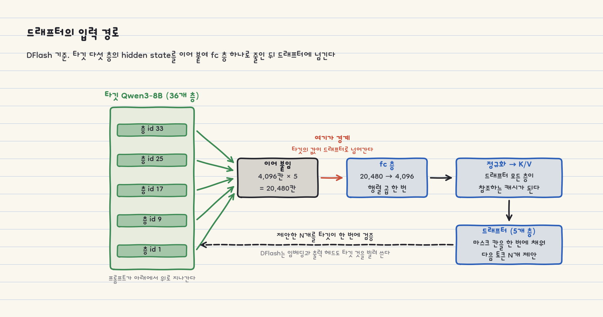
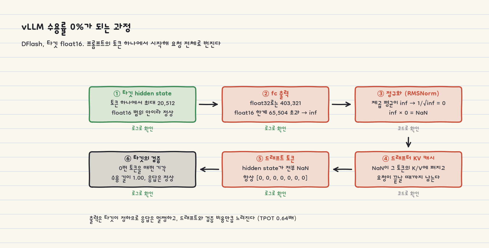

**이 글은 AI를 활용하여 작성되었습니다.**
{: .notice--info}

## 들어가며

[지난 글]({{ site.baseurl }})에서 여러 Speculative Decoding(이하 specdec) 방식을 RTX 5070 Ti에서 재보았고, 그 과정에서 dtype 이슈를 하나 겪었습니다. 4bit AWQ 모델에 DFlash 드래프터를 붙였더니 SGLang은 서버가 죽었고, vLLM은 요청이 전부 성공하는데 baseline보다 36~59% 느려졌던 문제입니다.

지난 글에서는 `--dtype bfloat16`을 주면 해결된다는 것까지만 적었는데, 이번 글에서는 아래 두 가지를 정리해보겠습니다.

1. 드래프터가 타깃 모델의 어느 층을 읽어서 어떻게 토큰을 제안하는지
2. 같은 조합에서 SGLang은 왜 죽고, vLLM은 왜 죽지 않고 수용률이 0이 되는지

결론부터 말씀드리면 아래와 같습니다.

- 드래프터는 타깃의 중간 층 hidden state를 받아서 동작하고, dtype 문제는 전부 그 값이 드래프터로 넘어갈 때 생겼습니다
- SGLang은 타깃과 드래프터를 서로 다른 dtype으로 올려서, 드래프터의 `fc`가 타깃의 hidden state를 곱할 때 죽습니다
- vLLM은 드래프터를 타깃의 dtype(float16)으로 바꿔서 올리는데, 드래프터의 계산값이 float16 범위를 넘어 NaN이 되고 모든 드래프트가 기각됩니다
- 해서 "두 모델의 dtype을 같게"가 아니라 "두 모델이 모두 안전하게 돌 수 있는 dtype으로 같게" 맞춰야 합니다

대상은 vLLM v0.33.0과 v0.34.0, SGLang v0.5.23이고, 타깃은 `Qwen/Qwen3-8B-AWQ`입니다. 코드 인용의 줄 번호도 이 버전 기준입니다.

## 드래프터 구조

지난 글에서 드래프터는 작은 LLM이라기보다 타깃 모델의 중간 계산을 빌려 쓰는 작은 헤드에 가깝다고 적었습니다. 이번에는 드래프터 체크포인트의 `config.json`과 가중치 파일을 열어서 실제로 어떻게 생겼는지 확인해보았습니다.

### 타깃에서 무엇을 받나

DFlash를 기준으로 그리면 아래와 같습니다.



타깃인 Qwen3-8B는 36개 층이고 층마다 4,096칸짜리 hidden state를 내놓습니다. hidden state는 모델이 토큰마다, 층마다 들고 있는 중간 계산 결과 벡터입니다. DFlash 드래프터는 이 중 다섯 층(`config.json`의 `aux_hidden_state_layer_ids`가 1, 9, 17, 25, 33)의 hidden state를 옆으로 이어 붙여 20,480칸으로 만들고, `fc` 층 하나로 다시 4,096칸으로 줄입니다. `fc`는 fully connected의 줄임말로, 가중치 행렬을 한 번 곱해서 벡터의 크기를 바꾸는 가장 기본적인 층입니다. 이 값을 정규화해서 드래프터의 모든 층이 참조하는 K/V로 넣어 두고, 드래프터는 그걸 보면서 다음 토큰들을 제안합니다.

여러 층을 받는 이유는 층마다 담긴 정보가 다르다고 알려져 있기 때문입니다. 그리고 타깃은 검증을 하느라 어차피 모든 층을 계산하므로, 드래프터 입장에서는 이미 계산된 값을 빌려 쓰기만 하면 됩니다. 반면 모든 층을 다 받으면 `fc`가 그만큼 커지기 때문에 간격을 두고 몇 개만 고릅니다.

### 방식별 차이

세 방식의 드래프터를 비교하면 아래와 같습니다.

| | EAGLE-3 | DFlash | DSpark |
|---|---|---|---|
| 파라미터 | 1.02B | 1.05B | 2.37B |
| 드래프터 층 수 | 1 | 5 | 5 |
| 읽는 타깃 층 | 3개 층 | 5개 층 (id 1, 9, 17, 25, 33) | 5개 층 (id 1, 9, 17, 25, 33) |
| `fc` 층 | 12,288 → 4,096 | 20,480 → 4,096 | 20,480 → 4,096 |
| 임베딩과 출력 헤드 | 임베딩 보유, 출력은 축소 어휘 32,000 | 없음 (타깃 것을 사용) | 자체 보유 |
| 제안하는 방법 | 한 토큰씩 이어서 | 마스크 칸을 한 번에 채움 | 한 번에 채운 뒤 순차 보정 |
| dtype | bfloat16 | bfloat16 | bfloat16 |

- **EAGLE-3** 는 층이 하나뿐인 드래프터가 토큰을 하나씩 이어서 제안합니다. 출력 어휘를 전체 151,936개가 아니라 32,000개로 줄여 둔 것이 특징입니다
- **DFlash** 는 제안할 자리를 마스크 토큰(아직 비어 있어서 채워야 할 자리라는 뜻의 특수 토큰)으로 채워 두고 forward 한 번으로 전부 채웁니다. 자기 임베딩과 출력 헤드가 없어서 타깃 없이는 아무것도 쓰지 못합니다
- **DSpark** 는 DFlash와 같은 병렬 구조 뒤에 작은 헤드가 두 개 더 붙습니다. 하나는 앞 토큰을 보고 다음 위치를 보정하고, 다른 하나는 어디까지 검증에 보낼지를 정합니다

EAGLE-3는 vLLM에서 쓴 체크포인트 기준이고, DFlash2는 층 수와 파라미터 수를 확인하지 못해서 표에 넣지 않았습니다.

여기서 기억해 둘 점은 두 가지입니다. 세 방식 모두 타깃의 hidden state가 `fc` 층으로 들어가는 경계가 있다는 것과, 드래프터가 전부 bfloat16으로 학습되어 저장돼 있다는 것입니다.

## dtype은 어디서 정해지나

"정밀도"라고 뭉뚱그려 부르는 것이 실제로는 서로 다른 네 가지 설정입니다.

| 설정 | 무엇을 정하나 | 어디서 정해지나 | 이번 조합의 값 |
|---|---|---|---|
| 가중치 양자화 | 타깃의 Linear 가중치를 저장하는 형식 | 체크포인트 | AWQ 4bit |
| 계산 dtype | 층 사이를 오가는 hidden state와 양자화되지 않은 가중치의 형식 | `--dtype`, 기본값은 `auto` | float16 |
| KV 캐시 dtype | attention의 K/V를 저장하는 형식 | `--kv-cache-dtype`, 기본은 계산 dtype | float16 |
| 드래프터 양자화 | 드래프터 가중치의 저장 형식 | 드래프터용 양자화 옵션 | 없음 |

이번 문제는 두 번째인 계산 dtype에서 생겼습니다. 보통은 `--dtype`을 따로 지정하지 않고, 기본값 `auto`가 체크포인트의 `config.json`에 적힌 값을 따릅니다. 그런데 같은 모델인데도 저장소마다 이 값이 달랐습니다.

| 체크포인트 | `config.json`의 dtype | 양자화 |
|---|---|---|
| `Qwen/Qwen3-8B` | bfloat16 | 없음 |
| `Qwen/Qwen3-8B-FP8` | bfloat16 | FP8 |
| `Qwen/Qwen3-8B-AWQ` | float16 | AWQ 4bit |
| 드래프터 다섯 개 | bfloat16 | 없음 |

AWQ 체크포인트만 float16입니다. 원본이나 FP8 모델을 올렸다면 타깃과 드래프터가 둘 다 bfloat16이라 아무 일도 없었을 텐데, 16GB에 맞추려고 AWQ를 고르면서 어긋나게 된 것입니다. 그리고 드래프터의 계산 dtype만 따로 지정하는 옵션은 두 엔진 모두 없었습니다.

### float16과 bfloat16

둘 다 16비트지만 비트를 다르게 나눠 씁니다.

| | 표현 가능한 최댓값 | 정밀도 |
|---|---|---|
| float16 | 약 65,504 | 높음 (유효 숫자 약 3.3자리) |
| bfloat16 | 약 3.4 × 10³⁸ | 낮음 (약 2.4자리) |

float16은 값이 65,504를 넘으면 `inf`가 되고, bfloat16은 그럴 일이 사실상 없습니다. 해서 bfloat16을 float16으로 바꾸는 것은 범위가 줄어드는 방향이고, bfloat16으로 학습한 모델은 중간값이 6만을 넘어도 문제없다는 전제로 만들어져 있습니다.

## SGLang은 왜 죽는가

SGLang은 타깃용 설정과 드래프터용 설정을 같은 함수로 만들고, `--dtype` 값도 둘에 똑같이 넘깁니다. 문제는 기본값 `auto`를 해석하는 부분입니다.

```python
# srt/configs/model_config.py  (_get_and_verify_dtype)
        config_dtype = config.get("dtype", None) or config.get("torch_dtype", None)
    ...
        if dtype == "auto":
            if config_dtype == torch.float32:
                ...
            else:
                torch_dtype = config_dtype      # 그 모델의 config.json 값을 그대로
```

"그 모델의 `config.json`에 적힌 값을 쓴다"가 규칙이라 모델마다 답이 달라집니다. 타깃은 float16, 드래프터는 bfloat16으로 올라가고, 기동 로그에도 `KV Cache is allocated. dtype: torch.float16`과 `dtype: torch.bfloat16`이 한 서버에 같이 찍힙니다.

### DFlash

첫 요청이 들어오면 타깃의 hidden state를 드래프터의 `fc` 층에 넣습니다. 그 직전 코드를 보면 장치와 정수 dtype은 맞추는데 실수 dtype은 건드리지 않습니다.

```python
# srt/speculative/dflash_worker_v2.py
        if target_hidden.device != device:
            target_hidden = target_hidden.to(device, non_blocking=True)   # 장치만 맞춤
        if cache_loc.dtype != torch.int64:
            cache_loc = cache_loc.to(torch.int64)                         # 정수 dtype은 맞춤
        ...
            ctx_hidden = self.draft_model.project_target_hidden(target_hidden)   # float16 그대로 전달

# srt/models/dflash.py
        projected = self.fc(target_hidden)     # fc의 가중치는 bfloat16, 입력은 float16
```

PyTorch는 dtype이 다른 두 행렬의 곱을 거부하기 때문에 여기서 죽습니다. 지난 글에서 본 에러가 이 줄에서 난 것입니다.

```
RuntimeError: expected mat1 and mat2 to have the same dtype, but got: c10::Half != c10::BFloat16
```

같은 파일의 다른 경계에는 dtype 변환이 들어가 있어서, 이 경로만 빠진 것으로 보입니다.

### EAGLE-3

EAGLE-3 드래프터는 메모리를 아끼려고 타깃의 임베딩 테이블을 복사하지 않고 그대로 가리킵니다.

```python
# srt/models/llama.py  (set_embed)
        del self.model.embed_tokens.weight
        self.model.embed_tokens.weight = embed      # 타깃의 float16 임베딩을 참조로 연결
```

해서 드래프터가 토큰을 임베딩하면 float16이 나오고, 바로 다음에 bfloat16 가중치를 가진 정규화 층으로 들어갑니다. 이번에는 PyTorch의 기본 연산이 아니라, SGLang이 직접 호출하는 FlashInfer 라이브러리의 RMSNorm 커널이 입력 dtype을 검사하다가 거부합니다. 해서 에러의 종류와 문구도 DFlash 때와 다릅니다. 그리고 서버가 기동하면서 드래프터를 미리 한 번 돌려 보는 단계(CUDA graph 캡처)에서 생기는 일이라, 요청을 받기도 전에 죽게 됩니다.

정리하면 SGLang에서는 `--dtype bfloat16`을 주는 순간 `auto`가 아니게 되어 두 모델이 같은 값을 받고, 그래서 문제가 사라집니다.

## vLLM은 왜 죽지 않고 0%가 되는가

vLLM은 SGLang과 반대로 동작합니다. 드래프터 설정을 만들 때 타깃의 dtype을 그대로 넘기고, 체크포인트의 dtype과 다르면 경고 한 줄을 남기고 가중치를 변환합니다.

```python
# vllm/config/model.py
        else:
            # Casting between float16 and bfloat16 is allowed with a warning.
            logger.warning("Casting %s to %s.", config_dtype, torch_dtype)
```

실패한 실행의 로그에도 `Casting torch.bfloat16 to torch.float16.` 한 줄이 남아 있었습니다. 해서 dtype이 달라 죽을 일은 없고, 대신 드래프터의 모든 계산이 float16으로 돌게 됩니다. 그 뒤에 일어나는 일을 그림으로 그리면 아래와 같습니다.



### fc 출력이 넘친다

타깃의 다섯 층을 이어 붙인 20,480칸을 `fc` 층에 넣고, 그 결과를 정규화하기 전 상태로 float16 버퍼에 저장합니다.

```python
# vllm/model_executor/models/qwen3_dflash.py  (combine_hidden_states)
        result = self.model.fc(hidden_states.to(self.model.fc.params_dtype))

# vllm/v1/worker/gpu/spec_decode/dflash/speculator.py
        self.hidden_states = torch.zeros(
            self.max_num_tokens, self.hidden_size, dtype=self.dtype, device=device   # float16
        )
        ...
        self.hidden_states[start:num_tokens].copy_(hidden_states)
```

20,480개의 값을 가중치와 곱해서 더하는 계산이라 결과가 커지기 쉬운데, float16의 한계는 65,504입니다.

### inf 하나가 NaN이 되어 캐시에 남는다

저장해 둔 값은 정규화(RMSNorm)를 거쳐 드래프터의 K/V가 됩니다. RMSNorm은 각 값에 `1/√(제곱 평균)`을 곱하는 계산입니다.

```cpp
// csrc/layernorm_kernels.cu
    s_variance = rsqrtf(variance / hidden_size + epsilon);
    ...
        dst.val[j] = static_cast<scalar_t>(x * s_variance * w);
```

`fc` 출력에 `inf`가 하나라도 있으면 아래 순서로 번집니다.

1. 제곱 평균이 `inf`가 되고, `rsqrtf(inf)`는 0이 됩니다
2. `inf × 0`은 NaN이라 그 토큰의 정규화 결과에 NaN이 생깁니다
3. K/V를 만드는 행렬 곱이 NaN을 그 토큰의 모든 층 K/V로 퍼뜨립니다
4. 그 K/V는 요청이 끝날 때까지 드래프터 캐시에 남고, 이후의 모든 드래프트가 이 토큰을 참조하므로 드래프터의 출력이 전부 NaN이 됩니다
5. 드래프트 토큰을 고르는 함수는 NaN을 -∞로 바꾼 뒤 가장 큰 것을 고르는데, 전부 -∞면 0번 토큰이 나옵니다

```python
# vllm/v1/worker/gpu/sample/greedy_argmax.py
        return logits.masked_fill(logits.isnan(), float("-inf")).argmax(dim=-1)
```

타깃은 0번 토큰을 매번 틀렸다고 판정합니다. 해서 수용률이 "낮은" 것이 아니라 모든 위치에서 정확히 0이고, 출력은 타깃이 정하기 때문에 응답은 정상이며, 속도만 드래프트와 검증 비용만큼 느려집니다. 지난 글에서 본 증상과 전부 맞습니다.

### 로그를 넣어서 확인

여기까지는 코드를 읽어서 세운 설명이라, 실제로 그런지 확인해보았습니다. vLLM의 `speculator.py` 두 군데(`fc` 출력을 저장한 직후, 드래프트를 만든 직후)에 로그를 넣고 요청 3건을 보냈습니다.

| 본 것 | 결과 |
|---|---|
| 프롬프트를 처음 넣을 때의 `fc` 출력 | 요청 3건 모두 한 행(토큰 하나)에서 값 7개가 `inf` |
| 같은 계산을 float32로 다시 했을 때 | 최대 절댓값 403,321 (float16 한계의 약 6배) |
| 그 행의 타깃 hidden state | 유한함. 다만 최대 절댓값이 20,512로 큼 |
| 생성 중 한 스텝씩 넣는 `fc` 출력 (62회) | 전부 유한. 최대 약 5,000~6,300 |
| 드래프트 직전 hidden state (43회) | 전부 NaN (28,672개 중 28,672개) |
| 드래프트 토큰 (43회) | 전부 `[0, 0, 0, 0, 0, 0, 0]` |

```
DFLASH_PROBE store call=2 rows=0:260 out_dtype=torch.float16 out_nonfinite=7/1064960 bad_rows=1 | aux: dtype=torch.float16 finite=True absmax=20512.00 per_layer_absmax=['53.2', '20096.0', '20512.0', '20512.0', '20448.0'] | fc_in_float32: absmax=403321.2 over_fp16_max=7/1064960
DFLASH_PROBE draft call=2 num_reqs=1 all_zero=True tokens_req0=[0, 0, 0, 0, 0, 0, 0] sample_hidden_nan=28672/28672
```

위 로그는 길어서 일부 필드를 생략했습니다. `fc` 출력이 넘치는 것과 드래프트가 전부 0번 토큰이 되는 것은 로그로 확인했고, 그 사이(정규화에서 NaN이 생겨 K/V로 퍼지는 부분)는 코드로만 확인했습니다.

로그를 보면서 알게 된 점도 있습니다. 넘치는 것은 프롬프트 전체가 아니라 토큰 하나였고, 프롬프트 길이가 다른 세 요청에서 그 행의 값이 똑같았습니다. 모든 요청에 공통으로 들어가는 토큰이라는 뜻이고, 채팅 템플릿의 첫 토큰일 것으로 보입니다.

### v0.34.0에서도 그대로

v0.34.0에는 `fc` 입력을 `fc`의 dtype으로 맞추는 변환이 한 줄 추가되어 있습니다(위 코드의 `.to(self.model.fc.params_dtype)`). 하지만 이건 타깃이 float32로 도는 경우를 위한 것이고, 타깃이 float16이면 이미 같은 dtype이라 아무 일도 하지 않습니다. 실제로 v0.34.0에서도 2,646개를 제안해서 0개가 받아들여졌습니다.

## dtype을 같게 맞추면 되는 것 아닌가

처음에는 "타깃과 드래프터의 dtype은 당연히 같아야 하는 것 아닌가"라고 생각했습니다. 연산 하나에 들어가는 두 텐서의 dtype이 같아야 하는 건 맞습니다. 하지만 엔진이 이 문제를 다루는 방법은 여러 가지입니다.

| 설계 | 내용 | 채택한 엔진 | 약점 |
|---|---|---|---|
| 드래프터를 타깃 dtype으로 | 드래프터를 만들 때 타깃의 dtype을 그대로 넘김 | vLLM | 드래프터를 학습 때보다 좁은 형식으로 돌리게 될 수 있음 |
| 각자 자기 dtype, 경계에서 변환 | 타깃의 값을 넘길 때 변환 | 없음 (SGLang은 일부 경계만 변환) | 손댈 경계가 여럿 |
| 다르면 기동 실패 | 두 dtype이 다르면 메시지와 함께 멈춤 | 없음 | 동작이 고쳐지지는 않음 |

vLLM에는 "같게 맞춘다"는 규칙이 이미 들어 있습니다. 이번 문제는 맞추지 않아서가 아니라, 드래프터에게 안전하지 않은 쪽(float16)으로 맞췄기 때문에 생긴 것입니다. 반면 SGLang에는 그 규칙이 없어서 다른 채로 올라가고, 드래프터가 타깃의 값을 받아 계산할 때 죽었습니다.

해서 실제로 지켜야 할 것은 "두 모델이 모두 안전하게 돌 수 있는 dtype으로 같게"이고, bfloat16으로 학습된 드래프터가 있다면 그 답은 bfloat16입니다.

참고로 `Qwen/Qwen3-8B-AWQ`는 `config.json`에 float16이라고 적혀 있지만, 양자화되지 않은 텐서(임베딩, 출력 헤드, norm)는 실제로 BF16으로 저장되어 있었습니다. `--dtype bfloat16`은 억지로 바꾸는 설정이 아니라 저장된 형식과 맞는 선택이기도 합니다.

## 해결과 그 대가

서버에 `--dtype bfloat16`을 주면 두 엔진 모두 해결됩니다. 실제로 본 조합을 수용 길이로 정리하면 아래와 같습니다(1.00이면 드래프트가 하나도 받아들여지지 않은 것입니다).

| 드래프터 | vLLM, float16 | vLLM, bfloat16 | SGLang, float16 | SGLang, bfloat16 |
|---|---|---|---|---|
| DFlash | 1.00 | 2.80 | 크래시 (첫 요청) | 2.78 |
| DFlash2 | 1.00 | 3.23 | 드래프터 형식을 못 읽음 | 드래프터 형식을 못 읽음 |
| EAGLE-3 | 2.27 | 2.25 | 크래시 (기동 중) | 2.28 |
| DSpark | 3.39 | 3.37 | 지원 안 함 | 지원 안 함 |

동작하는 방식은 dtype이 달라도 수용 길이가 거의 같았습니다(DSpark 3.39와 3.37, EAGLE-3 2.27과 2.25). 그리고 SGLang이 DFlash2를 읽지 못한 것은 드래프터 저장소가 vLLM용 형식이라서 생긴 일이고 dtype과는 관계가 없습니다.

다만 대가가 하나 있었습니다. 4bit 타깃을 bfloat16으로 돌리면 출력 재현성이 떨어집니다.

| 타깃 dtype | specdec 출력이 baseline과 완전히 일치한 비율 (160개 중) |
|---|---|
| float16 | 81~83% |
| bfloat16 | 22~27% |

bfloat16은 정밀도가 낮아서 1등과 2등 토큰이 뒤집히는 자리가 많아지는 것으로 보입니다. specdec이 답을 바꾼다기보다는, 같은 계산이 배치 모양에 따라 조금씩 달라지는 것이 순위를 더 자주 뒤집는 것입니다. 지난 글에서 specdec 없이 동시성만 바꿔도 같은 수준으로 달라졌던 것과 같은 이야기입니다.

해서 선택지는 두 가지입니다. bfloat16으로 모든 방식을 쓰거나, float16을 유지하면서 float16에서 동작하는 방식(vLLM의 DSpark, EAGLE-3)만 쓰는 것입니다.

## 배포 전에 확인할 것

이번 일을 겪고 나서 specdec을 올리기 전에 확인하게 된 것들입니다.

1. 타깃과 드래프터의 `config.json`에 적힌 dtype이 같은지 확인합니다. 4bit(AWQ, GPTQ) 타깃이면 float16일 가능성이 높습니다
2. 기동 로그를 확인합니다. vLLM은 드래프터에 대해 `Casting torch.bfloat16 to torch.float16.`이 찍히는지, SGLang은 `KV Cache is allocated. dtype:`이 타깃과 드래프터에서 같은지 봅니다
3. 수용 통계를 반드시 확인합니다. vLLM의 `Mean acceptance length`가 1.00이고 위치별 수용률이 전부 0.000이면 드래프터가 망가진 것입니다
4. baseline과 속도를 비교하고, specdec을 켠 쪽이 느리면 수용 길이부터 확인합니다

특히 3번은 오류 로그와 응답만으로는 보이지 않는 문제라, 수용 길이가 1.00에 붙어 있을 때 알람이 울리도록 해 두는 게 좋습니다.

## 마무리

이번에는 두 편에 걸쳐 speculative decoding을 살펴봤습니다. 실험과 트러블슈팅은 Claude Code의 힘을 많이 빌렸는데, 항상 느끼지만 덕분에 익숙지 않은 기술이나 신기술을 시도하는 데 드는 시간이 줄고 한결 편해졌습니다.

방식마다 기법이 다르고 복잡해서 세세한 내용까지 다 파악하지는 못했습니다. 다만 specdec의 원리와 서빙할 때 주의할 점을 가져가는 것에 의의를 둡니다.

GPU를 충분히 확보해서 서버당 동시 요청을 낮게 유지할 수 있거나, 트래픽은 적어도 응답 시간이 중요한 경우라면 specdec을 긍정적으로 검토해볼 만합니다. 반대로 동시 요청이 몰리는 서비스라면 켜는 쪽이 오히려 느려질 수 있어서, 실제 트래픽 수준에서 baseline과 비교해 본 뒤에 결정하는 것이 좋습니다.

## 레퍼런스

- [vLLM Speculative Decoding 문서](https://docs.vllm.ai/en/latest/features/speculative_decoding/)
- [SGLang Speculative Decoding 문서](https://docs.sglang.io/docs/advanced_features/speculative_decoding.md)
- [vLLM 이슈 #55250](https://github.com/vllm-project/vllm/issues/55250)
- [vLLM 이슈 #61072](https://github.com/vllm-project/vllm/issues/61072)
- [DFlash 논문](https://arxiv.org/abs/2602.06036)
- [Massive Activations in Large Language Models](https://arxiv.org/abs/2402.17762)
