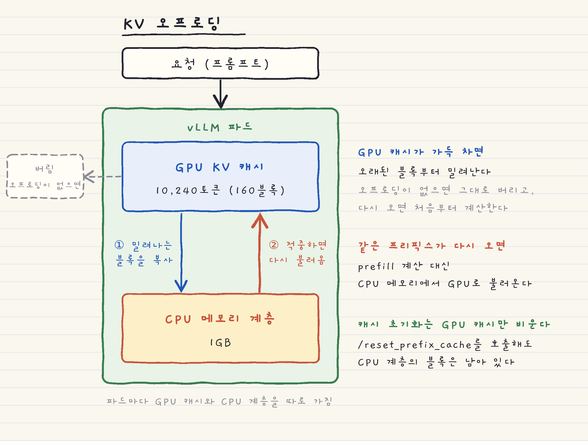

**이 글은 AI를 활용하여 작성되었습니다.**
{: .notice--info}

## 들어가며

[1편]({{ site.baseurl }})에서는 프리픽스를 보고 라우팅하면 캐시 적중률이 오른다는 것을, [2편]({{ site.baseurl }})에서는 Go 프록시와 llm-d의 차이가 라우터 재시작이나 파드 수 변경 같은 상황에서 나타난다는 것을 확인했습니다.

그런데 두 편의 실험에는 공통된 전제가 하나 있었습니다. 캐시가 넉넉했다는 점입니다. 파드 하나가 KV 캐시로 약 66,000토큰을 쓸 수 있었기 때문에, 한 번 캐시된 프리픽스가 밀려나는 일이 없었습니다. 하지만 실제 서빙에서는 모델이 크고 프롬프트가 길어서 GPU 메모리가 늘 모자라고, 오래된 캐시는 새 요청에 밀려나게 됩니다.

해서 이번에는 GPU 캐시를 일부러 줄여서 프리픽스가 밀려나는 상황을 만들어 보았습니다. 그리고 밀려난 캐시를 버리지 않고 CPU 메모리에 옮겨 두는 KV 오프로딩을 켰을 때 무엇이 달라지는지도 확인했습니다.

## 캐시를 줄이기

환경은 2편과 같은 k3s 클러스터이고, vLLM의 설정만 두 가지로 바꿔 가며 비교했습니다.

| 구성 | GPU KV 캐시 (파드당) | 밀려난 블록 | vLLM 옵션 |
|---|---|---|---|
| A. 캐시 압박 | 10,240토큰 | 버림 | `--num-gpu-blocks-override=160` |
| B. 캐시 압박 + 오프로딩 | 10,240토큰 | CPU 메모리 1GB로 옮김 | A + `--kv-offloading-backend=native --kv-offloading-size=1` |

블록 하나가 64토큰이니 160블록이면 10,240토큰입니다. 2편의 약 66,000토큰에서 6분의 1 수준으로 줄인 것이죠.

파드는 3개가 아니라 2개만 띄웠습니다. 오프로딩을 켠 vLLM 하나가 메모리를 약 6GiB 사용해서(끄면 약 3GiB), WSL에 할당한 24GB로는 3개가 빠듯했기 때문입니다. 해서 GPU 캐시는 두 파드를 합쳐 20,480토큰입니다.

부하는 2편에서 썼던 시스템 프롬프트 32종 부하를 그대로 사용했습니다. 시스템 프롬프트 하나가 약 560토큰이니 32종이면 약 18,000토큰이고, 여기에 대화가 쌓이는 부분까지 더하면 캐시에 다 들어가지 않습니다. 그리고 같은 대화를 한 번 더 보내는 단계를 추가했습니다. 밀려난 프리픽스로 다시 돌아오는 요청이 어떻게 되는지를 보기 위해서입니다.

라우터는 2편의 4종에 하나를 더했습니다. llm-d 가이드에 있는 구성으로, GPU 캐시용과 CPU 계층용 근사 인덱스를 따로 두는 라우터입니다. 아래에서는 llm-d 계층이라고 부르겠습니다.

## 캐시가 모자라면

먼저 오프로딩 없이 캐시만 줄인 A의 결과입니다. 정책마다 순서를 바꿔 2번씩 돌렸고, 기준은 같은 구성에서 시스템 프롬프트 4종 부하를 보낸 값입니다 (1회).

| 정책 | 기준 (4종) | 32종 | 32종 다시 보냄 | 다시 보낼 때 첫 턴 |
|---|---|---|---|---|
| 라운드로빈 | 0.76 | 0.58\~0.60 | 0.58\~0.60 | 0.03\~0.09 |
| Go 프록시 | 0.85 | 0.75 | 0.77\~0.79 | 0.27 |
| llm-d 근사 | 0.84 | 0.75 | 0.78 | 0.20\~0.22 |
| llm-d 정밀 | 0.85 | 0.75 | 0.79 | 0.27 |
| llm-d 계층 | 0.81 | 0.75\~0.76 | 0.77\~0.78 | 0.12\~0.20 |

캐시에 들어가는 부하에서는 0.76 / 0.81\~0.85였던 적중률이, 캐시에 다 들어가지 않는 부하에서는 0.58\~0.60 / 0.75로 떨어졌습니다. 캐시된 프리픽스가 다시 쓰이기 전에 밀려나서 다시 계산해야 하는 경우가 늘어난 것입니다.

더 눈에 띄는 것은 같은 대화를 다시 보냈을 때입니다. 방금 전에 보낸 대화인데도 첫 턴의 적중률이 0.03\~0.27밖에 되지 않았습니다. 캐시가 넉넉했던 2편에서는 같은 대화를 다시 보냈을 때 첫 턴이 0.9 안팎이었으니, 대화가 끝나고 다른 요청들이 들어오는 사이에 그 대화의 캐시가 거의 다 밀려났다는 뜻입니다.

### 근사와 정밀의 차이

캐시가 밀려나는 상황이라면 근사와 정밀의 차이가 드러나지 않을까 했는데, 적중률로는 차이가 보이지 않았습니다. 32종에서는 Go 프록시, llm-d 근사, llm-d 정밀이 모두 0.75였고, 다시 보낼 때도 0.77\~0.79로 비슷했습니다.

차이가 난 것은 라우터가 예측한 적중률이었습니다.

| 정책 | 라우터가 예측한 적중률 | 실제 적중률 |
|---|---|---|
| Go 프록시 | 0.89\~0.90 | 0.77\~0.79 |
| llm-d 정밀 | 0.79 | 0.79 |

같은 대화를 다시 보낼 때 Go 프록시는 0.89\~0.90이 적중할 것이라고 봤지만 실제로는 0.77\~0.79였습니다. 보낸 기록만 가지고 있으니 밀려난 캐시도 아직 있다고 보는 것이죠. 반면 llm-d 정밀은 예측과 실제가 0.79로 같았습니다. vLLM이 블록을 지울 때 보내는 이벤트를 받기 때문에 무엇이 밀려났는지를 정확히 알고 있었습니다.

그런데도 적중률이 같았던 이유는, 밀려난 캐시는 어느 파드에도 없기 때문이라고 이해했습니다. 정밀 방식은 캐시가 없다는 사실을 정확히 알지만, 그렇다고 없는 캐시를 쓸 수 있게 되는 것은 아닙니다. 라우팅은 있는 캐시를 찾아가는 일이고, 캐시가 모자란 문제는 라우팅만으로는 해결되지 않았습니다.

## KV 오프로딩을 켜면

KV 오프로딩은 GPU 캐시에서 밀려나는 블록을 버리지 않고 CPU 메모리로 옮겨 두는 기능입니다. 나중에 같은 프리픽스가 다시 오면 처음부터 계산하는 대신 CPU 메모리에서 GPU로 다시 불러옵니다. GPU 메모리보다 훨씬 넉넉한 호스트 메모리를 캐시의 두 번째 계층으로 쓰는 셈입니다.



vLLM에서는 위 구성 표의 옵션 두 개로 켤 수 있었습니다. `--kv-offloading-backend=native`로 기능을 켜고 `--kv-offloading-size=1`로 CPU 계층의 크기를 GB 단위로 정하는데, 여기서는 파드당 1GB를 주었습니다. A와 같은 순서로 부하를 보낸 결과입니다.

| 정책 | 32종 다시 보냄 (A → B) | 다시 보낼 때 첫 턴 (A → B) | CPU 계층에서 불러온 토큰 |
|---|---|---|---|
| 라운드로빈 | 0.58\~0.60 → 0.83\~0.84 | 0.03\~0.09 → 0.87\~0.92 | 38,272\~42,944 |
| Go 프록시 | 0.77\~0.79 → 0.89 | 0.27 → 0.88\~0.90 | 20,224\~20,864 |
| llm-d 근사 | 0.78 → 0.85 | 0.20\~0.22 → 0.64\~0.68 | 15,168\~15,296 |
| llm-d 정밀 | 0.79 → 0.89\~0.90 | 0.27 → 0.90\~0.92 | 20,416\~20,864 |
| llm-d 계층 | 0.77\~0.78 → 0.88 | 0.12\~0.20 → 0.83 | 19,072\~19,904 |

표의 값은 부하 생성기가 실행마다 남기는 요약에서 가져왔습니다. 아래는 라운드로빈으로 같은 대화를 다시 보낸 실행 하나의 요약 중 일부입니다.

```json
{
  "label": "k8s-rr-offload-cold-replay",
  "requests": 240,
  "errors": 0,
  "prompt_tokens": 197695,
  "cached_tokens": 164096,
  "actual_hit_ratio": 0.8300462834163737,
  "offload_hit_tokens": 38272,
  "offload_load_bytes": 1097334784
}
```

`actual_hit_ratio`는 `cached_tokens`를 `prompt_tokens`로 나눈 값이고, `offload_hit_tokens`는 CPU 계층에서 GPU로 다시 불러온 토큰 수입니다. vLLM의 `vllm:external_prefix_cache_hits_total` 지표가 실행 전후로 얼마나 늘었는지를 읽은 값이죠. 이 실행에서는 적중한 164,096토큰 중 38,272토큰이 CPU 계층에서 온 것입니다.

같은 대화를 다시 보냈을 때 첫 턴의 적중률이 0.03\~0.27에서 0.64\~0.92로 회복됐습니다. GPU 캐시에서는 밀려났지만 CPU 메모리에 남아 있던 블록을 다시 불러온 것입니다. 전체 적중률도 0.07에서 0.25까지 올랐습니다.

처음 보는 프리픽스를 보내는 단계에서도 조금 올랐습니다 (라운드로빈 0.58\~0.60 → 0.67, 캐시를 보는 정책 0.75 → 0.77\~0.79). 대화 도중에 밀려났던 시스템 프롬프트를 CPU 계층에서 다시 가져온 것으로 보입니다.

### 캐시 초기화와 CPU 계층

위 표는 두 번째로 잰 값입니다. 처음에는 A와 같은 방식으로, 실행마다 vLLM의 캐시 초기화 엔드포인트(`/reset_prefix_cache`)를 호출하고 같은 대화를 보냈습니다. 그런데 결과가 이상했습니다. 캐시를 비웠는데도 실행 직후 첫 8개 대화의 첫 턴부터 4,096토큰, 4,473토큰이 적중했습니다. A에서는 같은 지점이 0이었습니다.

원인은 캐시 초기화가 GPU 캐시만 비운다는 것이었습니다. CPU 계층에는 이전 실행이 남긴 블록이 그대로 있었고, 같은 대화를 보내니 처음부터 그 블록을 불러온 것입니다. 해서 실행마다 한 번도 보낸 적 없는 프롬프트를 쓰도록 바꿔서 다시 측정했습니다.

이 성질은 뒤에서 오히려 유용하게 쓰였습니다. GPU 캐시만 비우고 같은 프롬프트를 다시 보내면 CPU 계층에서 불러오는 경우만 골라서 잴 수 있기 때문입니다.

## 오프로딩과 라우팅

앞의 오프로딩 결과 표에서 가장 크게 회복된 것은 라운드로빈입니다. 0.58\~0.60에서 0.83\~0.84로 올랐고, 그 결과 캐시를 보는 정책과의 차이가 약 0.19에서 약 0.05로 줄었습니다.

대신 CPU 계층에서 불러온 토큰 수가 달랐습니다. 라운드로빈은 약 4만 토큰을 불러왔고, 캐시를 보는 정책은 약 2만 토큰이었습니다. 라운드로빈은 요청을 캐시가 없는 파드로 보내는 경우가 많으니, 그만큼 CPU 계층에 더 자주 기대게 되는 것입니다.

그렇다면 오프로딩이 있으면 라우팅은 덜 중요해지는 걸까요? 이 실험으로 말할 수 있는 것은 차이가 줄었지만 없어지지는 않았고, 라운드로빈은 같은 결과를 위해 CPU 계층에서 두 배를 불러와야 했다는 것까지입니다. CPU에서 불러오는 것도 비용이 있다는 점은 아래에서 따로 확인했습니다.

그리고 GPU와 CPU 인덱스를 따로 두는 llm-d 계층 라우터는 llm-d 정밀이나 Go 프록시보다 높게 나오지 않았습니다 (0.88 대 0.89\~0.90). llm-d 근사는 오프로딩을 켠 뒤 첫 턴 적중률이 다른 정책보다 낮았습니다 (0.64\~0.68).

## 적중률과 속도

그런데 속도를 보고 나서 의문이 생겼습니다. 적중률이 이만큼 올랐는데 처리량과 TTFT는 거의 그대로였습니다.

| | 처리량 (tok/s) |
|---|---|
| A. 캐시 압박 | 976\~1,084 |
| B. 캐시 압박 + 오프로딩 | 956\~1,105 |

TTFT p50도 정책과 실행에 따라 60\~110ms 사이에서 오르내릴 뿐, 오프로딩을 켰다고 내려가지는 않았습니다. 1편에서 적중률이 0.19 벌어졌는데 TTFT는 4\~5ms밖에 차이 나지 않았던 것과 같은 현상입니다.

캐시가 적중하면 그만큼의 prefill 계산을 건너뛰는데 왜 빨라지지 않는 걸까요? 프롬프트가 너무 짧아서 건너뛰는 계산이 원래 작기 때문이라고 추측했고, 이를 확인하려고 프롬프트 길이를 바꿔 가며 따로 재 보았습니다.

## 프롬프트 길이별 TTFT

오프로딩을 켠 vLLM 파드 하나에 라우터 없이 요청을 하나씩 보냈습니다. 프롬프트 길이 네 가지에 대해 세 가지 경우를 쟀고, 길이마다 새 프롬프트로 5번씩 재서 중앙값을 냈습니다.

- 캐시 없음. 처음 보내는 프롬프트
- GPU 적중. 같은 프롬프트를 바로 다시 보냄
- CPU 계층 적중. GPU 캐시만 비운 뒤 같은 프롬프트를 다시 보냄

| 프롬프트 토큰 | 캐시 없음 | GPU 적중 | CPU 계층 적중 |
|---|---|---|---|
| 524 | 52ms | 29ms | 37ms |
| 1,979 | 144ms | 31ms | 39ms |
| 3,914 | 266ms | 37ms | 55ms |
| 6,841 | 506ms | 40ms | 70ms |

캐시가 없을 때의 TTFT는 프롬프트 길이에 거의 비례해서 늘어났습니다. 토큰당 약 0.07ms이고, 6,841토큰이면 506ms입니다. 반면 GPU 캐시에 적중하면 길이와 거의 무관하게 29\~40ms였습니다. prefill을 건너뛰고 바로 생성을 시작하기 때문입니다.

CPU 계층에서 불러오는 경우는 그 사이였는데, GPU 적중보다 8\~30ms가 더 걸렸습니다. 불러올 블록이 많을수록 조금씩 늘어나지만, 6,841토큰에서도 70ms로 캐시가 없을 때의 506ms와는 비교가 되지 않습니다.

이 표로 앞의 의문이 풀렸습니다. 부하 실험의 프롬프트는 약 560토큰부터 시작하는데, 이 길이에서는 캐시가 적중해도 아끼는 시간이 20ms 남짓입니다. 적중률이 0.1 오르면 요청당 평균 몇 ms가 줄어드는 셈이고, 이 정도는 실행 간 편차에 묻혀서 보이지 않았던 것입니다. 반대로 프롬프트가 7,000토큰이라면 적중 한 번이 450ms 이상을 아낍니다. 1편에서 언급했던 5,000\~12,000토큰짜리 프로덕션 시스템 프롬프트라면 캐시 적중률은 곧 TTFT가 됩니다.

다만 이 계산은 길이별 측정값을 부하 실험에 대입해 본 것이고, 부하가 걸린 상태에서 따로 분리해서 잰 것은 아닙니다.

## 마무리

3편에서 확인한 것은 다음과 같습니다.

| 상황 | 결과 | 근거 |
|---|---|---|
| 캐시가 모자랄 때 | 적중률이 떨어지고, 돌아온 대화의 첫 턴은 거의 적중하지 않는다 | 0.76 / 0.81\~0.85 → 0.58\~0.60 / 0.75, 첫 턴 0.03\~0.27 |
| 정밀 방식의 이점 | 밀려난 것을 정확히 알지만 적중률은 같다 | 예측 0.79 대 실제 0.79, Go 프록시는 0.89\~0.90 대 0.77\~0.79 |
| KV 오프로딩 | 적중률이 회복된다 | 다시 보낼 때 0.83\~0.90, 첫 턴 0.64\~0.92 |
| 오프로딩과 라우팅 | 라우팅이 나쁠수록 더 메우지만 그만큼 더 불러온다 | 차이 약 0.19 → 약 0.05, 약 4만 대 2만 토큰 |
| 속도 | 이 부하에서는 그대로, 프롬프트가 길수록 이득이 크다 | 6,841토큰에서 506ms / 40ms / 70ms |

물론 한계도 있습니다.

- CPU 계층은 파드 안에 있어서 파드가 재시작하면 같이 사라집니다. 새로 뜬 파드나 오토스케일링으로 늘어난 파드에는 도움이 되지 않고, 그러려면 파드 밖에서 공유하는 계층이 필요한데 이 부분은 고려하지 않았습니다.
- 오프로딩에도 비용이 있어 보였습니다. 처음 보는 프리픽스를 보내는 단계에서 오프로딩을 켰을 때, 가장 느린 요청들의 TTFT(p99)가 416\~577ms로 오프로딩이 없을 때(194\~225ms)의 두 배를 넘었습니다. 중앙값은 비슷했습니다. GPU에서 밀려나는 블록을 CPU 메모리로 옮기는 작업이 일부 요청을 늦춘 것으로 추정하지만 확인하지는 못했습니다.
- 길이별 측정은 파드 하나에 요청을 하나씩 보낸 값이라 부하가 걸린 상태와는 다를 수 있습니다. 그리고 524토큰의 캐시 없음 5번 중 1번은 이전 실행의 블록이 적중해서, 그 값을 빼면 중앙값은 58ms입니다.

### 세 편을 돌아보며

처음의 의문은 LiteLLM에 로드밸런싱이 있는데 llm-d 같은 추론 스케줄러가 왜 따로 필요한가였습니다. 세 편에 걸쳐 확인한 것을 정리하면 다음과 같습니다.

- 프리픽스를 보고 라우팅하면 캐시 적중률과 처리량이 오릅니다. 이건 400줄짜리 Go 프록시로도 됐습니다.
- 추론 스케줄러가 해 주는 일은 파드가 늘고 줄고 라우터가 재시작하는 상황에서도 그 라우팅이 유지되게 하는 것이었습니다.
- 캐시가 모자라면 라우팅만으로는 부족하고, 오프로딩 같은 캐시 계층이 그 자리를 메웁니다.
- 그리고 프롬프트 길이가 길 때, 유의미한 차이가 더 발생한다는 걸 알 수 있었습니다.

VRAM 16GB짜리 GPU 한 장과 1.5B 모델로 한 실험이라 수치 자체를 그대로 가져다 쓸 수는 없습니다. 하지만 문서로만 읽었던 프리픽스 캐시, 캐시 인지 라우팅, KV 오프로딩이 각각 어떤 문제를 풀고 어디까지 풀어 주는지는 숫자로 확인할 수 있었습니다.

## 참고 자료

- vLLM Documentation. *Automatic Prefix Caching*. [docs.vllm.ai](https://docs.vllm.ai/en/stable/design/prefix_caching/)
- llm-d. [llm-d.ai](https://llm-d.ai/)
- llm-d GitHub Repository. [github.com/llm-d/llm-d](https://github.com/llm-d/llm-d)
